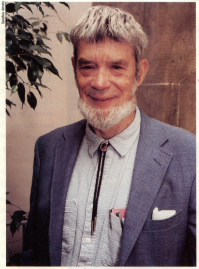

# Antagonistic pleiotropy

**Antagonistic pleiotropy** is the situation in which one allele has effects of opposite sign on different components of fitness. In the evolutionary theory of ageing the term means one specific case: an allele that raises survival or fecundity at some ages and lowers them at others, compared with the allele it replaces. Because natural selection weighs an effect by the share of the carrier's expected reproduction still ahead of it, an allele with a small benefit early in adult life can spread even if it carries a much larger cost later. Ageing is then, in part, the late cost of such alleles. The idea was set out by [[george-c-williams|George C. Williams]] in 1957,[^williams1957] after Peter Medawar had remarked on the possibility in passing,[^medawar1952] and was given its mathematical form by [[wd-hamilton|W. D. Hamilton]] in 1966 and Brian Charlesworth in 1980.[^hamilton1966][^charlesworth1980]

Antagonistic pleiotropy is one of two population-genetic mechanisms by which selection's declining force with age produces ageing. The other is [[selection-shadow-theory|mutation accumulation]]: alleles that only harm late in life drift to appreciable frequency because selection against them is weak. The [[disposable-soma-theory|disposable soma theory]] is a physiological version of antagonistic pleiotropy, in which the opposing effects arise from allocating a limited budget between reproduction and maintenance.[^kirkwoodrose1991] The theory is supported most directly by negative genetic correlations between early reproduction and later survival in *Drosophila*, and by selection experiments in which flies bred late in life evolved longer lives.[^rosecharlesworth1981a][^rose1984][^luckinbill1984] Individual genes with demonstrated antagonistic effects on measured fitness are fewer than the theory's prominence suggests.[^leroi2005]

The theory is often summarised as "genes that are useful when young and harmful when old". The summary is loose in ways that matter. It is regularly applied to mechanisms, such as replicative telomere shortening, whose protective effect does not stop with age, and whose removal late in life would be expected to shorten life rather than lengthen it. [Misapplications](#misapplications) sets out what the definition requires and where the shorthand departs from it.

## Definitions

**Pleiotropy** is the effect of one gene on more than one trait. The word, *Pleiotropie*, was coined by Ludwig Plate in 1910.[^stearns2010] An early recorded case is in Mendel's 1866 paper: the factor that made pea flowers white also made the seed coat white, while violet flowers came with "grey, grey-brown, leather-brown" seed coats and a reddish tint in the leaf axils.[^mendel1866] The gene was identified in 2010 as a bHLH transcription factor that controls anthocyanin pigment throughout the plant; Mendel's white allele most likely carries a splice-site mutation that truncates the protein.[^hellens2010]

Pleiotropy is **antagonistic** when an allele's effects on two fitness components have opposite signs. The standard example known by 1957 is the sickle-cell allele of haemoglobin, HbS. Anthony Allison showed in 1954 that Ugandan children carrying one copy had fewer and lighter *Plasmodium falciparum* infections,[^allison1954] while two copies cause sickle-cell disease. Its two effects differ in dominance, not in age, so selection holds the allele at an intermediate frequency where malaria is common.

In the theory of ageing, the fitness components are **age-specific**: the probability of surviving from age $x$ to $x + 1$, and fecundity at age $x$. An allele shows antagonistic pleiotropy across ages when it raises some of these and lowers others. Three features of the definition are easily lost:

1. **The comparison is between genotypes.** "Lowers survival at 70" means that carriers alive at 70 survive the year less often than non-carriers alive at 70, where each has carried their allele for life. It is not a statement about what would happen if the allele's product were removed at 70 (see [below](#late-removal-is-a-different-counterfactual)).
2. **The effect at each age is a net effect.** An allele can impose a cost at some age and still raise survival at that age, if its benefits at the same age are larger. Only the sign of the net effect counts.
3. **The effects are on fitness components.** Health, tissue function or a biomarker matter only through survival and reproduction.

> [!note]- Formal definitions
> Let $l(x)$ be the probability of surviving from birth to age $x$, $m(x)$ the expected number of daughters born per year at age $x$, and $\mu(x)$ the mortality rate. In a population with a stable age structure, the growth rate $r$ solves the Euler–Lotka equation
>
> $$
> \int_0^\infty e^{-rx}\,l(x)\,m(x)\,\mathrm{d}x = 1, \qquad l(x) = \exp\!\left(-\int_0^x \mu(t)\,\mathrm{d}t\right).
> $$
>
> Differentiating gives the sensitivities of $r$ to the mortality rate and to fecundity at age $a$:[^hamilton1966][^charlesworth1980]
>
> $$
> \frac{\partial r}{\partial \mu(a)} = -\frac{1}{T}\int_a^\infty e^{-rx}\,l(x)\,m(x)\,\mathrm{d}x, \qquad \frac{\partial r}{\partial m(a)} = \frac{e^{-ra}\,l(a)}{T},
> $$
>
> where $T = \int_0^\infty x\,e^{-rx}\,l(x)\,m(x)\,\mathrm{d}x$ is the generation time. Hamilton wrote the first in discrete form as the effect of a change in $\ln p_a$, the logarithm of the probability of surviving from $a$ to $a+1$, with the sum of $e^{-rx} l_x m_x$ over $x \ge a + 1$ in place of the integral.
>
> Write $s(a) = \int_a^\infty e^{-rx} l(x) m(x)\,\mathrm{d}x$, the share of a newborn's discounted expected reproduction that is still ahead at age $a$. A rare allele that lowers the mortality rate by $\varepsilon_1$ for a year at age $x_1$ and raises it by $\varepsilon_2$ for a year at age $x_2$ changes $r$ by approximately $(\varepsilon_1 s(x_1) - \varepsilon_2 s(x_2))/T$, and so spreads under weak selection when
>
> $$
> \frac{\varepsilon_2}{\varepsilon_1} < \frac{s(x_1)}{s(x_2)}.
> $$
>
> Since $s$ is constant before the first age of reproduction and falls to zero after the last, the right-hand side is unbounded for any $x_2$ beyond the end of reproduction.

## Williams's argument

### Before 1957

August Weismann had proposed in 1891 that natural selection designed a specific mechanism to remove old individuals, possibly a limit on the number of divisions somatic cells could undergo. Williams listed four objections: it identified senescence with mechanical wear; individuals old enough to die by such a mechanism are extremely rare in nature; decades of gerontology had found no such mechanism; and it was hard to see how selection could produce one.[^williams1957]

Ronald Fisher had noted in 1930 that selection acts less strongly at ages by which most of an individual's reproduction is complete, and J. B. S. Haldane and Medawar developed the point.[^charlesworth2000] Medawar's 1952 lecture argued that a mutation whose harm appears late enough "may be completely unimportant" to selection, and that such mutations would therefore accumulate, the mechanism now called mutation accumulation.[^medawar1952] Medawar also noted that genes with early benefits could be favoured despite late costs, but did not develop the idea.

### Pleiotropy, Natural Selection, and the Evolution of Senescence



Williams's paper made the second mechanism the centre of the theory.[^williams1957] Selection, he argued, would favour an allele whose early benefit outweighs its late cost, because the late cost falls on fewer individuals, with less of their reproduction ahead of them. He illustrated the idea with a hypothetical allele that favoured calcification of bone during development but went on to calcify the walls of arteries in later life. This was a thought experiment, not an identified gene.

The argument was verbal. From it Williams drew nine "testable deductions", which Jean-Michel Gaillard and Jean-François Lemaître reappraised in 2017. They found six of the nine mostly supported, at least under some conditions; the three that fail all concern the timing of senescence.[^gaillard2017] The deductions most often discussed are these:

| Williams's deduction (paraphrased except where quoted) | Later evidence |
| --- | --- |
| Low adult mortality should go with slow senescence, and high adult mortality with rapid senescence. | Formal theory shows that mortality acting equally at all ages does not change selection on ageing.[^caswell2007][^moorad2019] Field tests conflict: island opossums with few predators senesce more slowly,[^austad1993] but guppies from high-predation streams do not senesce faster.[^reznick2004] |
| “Senescence should be more rapid in those organisms that do not increase markedly in fecundity after maturity than those that do show such an increase.” | Consistent with species with [[Indeterminate growth\|indeterminate growth]] and rising fecundity, some of which show flat or falling adult mortality.[^jones2014] |
| Senescence should begin at the age of reproductive maturity. | A deduction about timing; the three deductions the 2017 reappraisal found unsupported all concern the timing of senescence.[^gaillard2017] |
| The sex with the higher adult mortality should senesce faster. | Discussed in the reappraisal; depends on how mortality differs between the sexes by age, for the same reason as the first deduction.[^gaillard2017][^moorad2019] |
| There should be little or no post-reproductive period in natural populations. | Contradicted by humans and some other social species; Ronald Lee traced the post-reproductive lifespan to transfers from old to young.[^lee2003] |
| Organisms without a separation of soma and germ line should not senesce. | Developed by the disposable soma theory.[^kirkwood1977] |

## The force of selection

Hamilton made the argument quantitative in 1966. He measured fitness by the population growth rate $r$ and asked how much $r$ changes when survival at one age changes. The answer, his indicator of the force of selection on survival, is proportional to the expected reproduction that still lies ahead at that age.[^hamilton1966] Selection on survival is therefore constant from birth to the first age of reproduction, declines through the reproductive years, and reaches zero after the last. The same quantity sets the exchange rate between early and late effects: an allele is favoured if its early benefit, weighted by the force of selection at the early age, exceeds its late cost, weighted by the force at the late age.

Figure 1 computes the force of selection for American women from the 2023 life table and birth rates. Half of a newborn girl's expected reproduction is still ahead of her at 30; less than 5% at 40; none after 49. Set the two sliders to see the exchange rate. A fall in the mortality rate at 20 pays for a rise up to 21 times as large at 40, and up to about 250 times as large at 45. At 50 and over, selection accepts any cost at all.

```vega-lite
{
  "$schema": "https://vega.github.io/schema/vega-lite/v6.json",
  "description": "Figure 1. Hamilton's force of selection on survival, for American women in 2023. Top: births per woman per year at each age. Bottom: the share of a newborn girl's expected lifetime reproduction that is still ahead of her at each age, which is proportional to how strongly selection acts on the mortality rate at that age (scaled to 1 at birth). The sliders set the age at which an allele lowers the mortality rate and the age at which it raises it; the label gives the largest rise that selection would accept in exchange.",
  "params": [
    {
      "name": "x1",
      "value": 20,
      "bind": {
        "input": "range",
        "min": 0,
        "max": 45,
        "step": 1,
        "name": "Age of the benefit x₁"
      }
    },
    {
      "name": "x2",
      "value": 40,
      "bind": {
        "input": "range",
        "min": 15,
        "max": 60,
        "step": 1,
        "name": "Age of the cost x₂"
      }
    }
  ],
  "spacing": 14,
  "vconcat": [
    {
      "height": 80,
      "data": {
        "url": "/attachments/us-force-of-selection-2023.csv"
      },
      "mark": {
        "type": "area",
        "style": "observed",
        "opacity": 0.45,
        "interpolate": "step-after"
      },
      "encoding": {
        "x": {
          "field": "age",
          "type": "quantitative",
          "scale": {
            "domain": [
              0,
              60
            ],
            "nice": false
          },
          "axis": {
            "title": null,
            "values": [
              0,
              10,
              20,
              30,
              40,
              50,
              60
            ],
            "labels": false,
            "ticks": false,
            "domain": false
          }
        },
        "y": {
          "field": "fertility",
          "type": "quantitative",
          "scale": {
            "domain": [
              0,
              0.1
            ]
          },
          "axis": {
            "title": "Births a year",
            "values": [
              0,
              0.05,
              0.1
            ]
          }
        }
      }
    },
    {
      "height": 240,
      "layer": [
        {
          "data": {
            "url": "/attachments/us-force-of-selection-2023.csv"
          },
          "mark": {
            "type": "line",
            "style": "model"
          },
          "encoding": {
            "x": {
              "field": "age",
              "type": "quantitative"
            },
            "y": {
              "field": "force",
              "type": "quantitative"
            }
          }
        },
        {
          "data": {
            "values": [
              {}
            ]
          },
          "mark": {
            "type": "rule",
            "style": "guide"
          },
          "encoding": {
            "x": {
              "datum": {
                "expr": "x1"
              },
              "type": "quantitative"
            }
          }
        },
        {
          "data": {
            "values": [
              {}
            ]
          },
          "mark": {
            "type": "rule",
            "style": "guide"
          },
          "encoding": {
            "x": {
              "datum": {
                "expr": "x2"
              },
              "type": "quantitative"
            }
          }
        },
        {
          "data": {
            "url": "/attachments/us-force-of-selection-2023.csv"
          },
          "transform": [
            {
              "filter": "datum.age == x1 || datum.age == x2"
            },
            {
              "calculate": "datum.age == x1 ? 'x₁' : 'x₂'",
              "as": "which"
            }
          ],
          "layer": [
            {
              "mark": {
                "type": "circle",
                "style": "model-point",
                "size": 70
              }
            },
            {
              "mark": {
                "type": "text",
                "style": "model-label",
                "align": "left",
                "dx": 8,
                "dy": -10
              },
              "encoding": {
                "text": {
                  "field": "which"
                }
              }
            }
          ],
          "encoding": {
            "x": {
              "field": "age",
              "type": "quantitative"
            },
            "y": {
              "field": "force",
              "type": "quantitative"
            }
          }
        },
        {
          "data": {
            "url": "/attachments/us-force-of-selection-2023.csv"
          },
          "transform": [
            {
              "calculate": "datum.age == x1 ? datum.force : 0",
              "as": "f1"
            },
            {
              "calculate": "datum.age == x2 ? datum.force : 0",
              "as": "f2"
            },
            {
              "aggregate": [
                {
                  "op": "sum",
                  "field": "f1",
                  "as": "f1"
                },
                {
                  "op": "sum",
                  "field": "f2",
                  "as": "f2"
                }
              ]
            },
            {
              "calculate": "datum.f1 / datum.f2",
              "as": "ratio"
            },
            {
              "calculate": "[{'line': 0}, {'line': 1}, {'line': 2}]",
              "as": "lines"
            },
            {
              "flatten": [
                "lines"
              ]
            },
            {
              "calculate": "datum.lines.line",
              "as": "line"
            },
            {
              "calculate": "datum.f1 == 0 ? (datum.line == 0 ? 'Selection no longer' : datum.line == 1 ? 'acts at ' + x1 + ': the benefit' : 'buys nothing') : datum.f2 == 0 ? (datum.line == 0 ? 'A fall at ' + x1 + ' pays for' : datum.line == 1 ? 'any rise at ' + x2 + ':' : 'selection no longer acts') : (datum.line == 0 ? 'A fall at ' + x1 + ' pays for' : datum.line == 1 ? 'a rise at ' + x2 + ' up to' : (datum.ratio >= 100 ? format(datum.ratio, ',.0f') : format(datum.ratio, '.2~r')) + ' times as large')",
              "as": "label"
            },
            {
              "calculate": "59",
              "as": "lx"
            },
            {
              "calculate": "1.0 - 0.085 * datum.line",
              "as": "ly"
            }
          ],
          "mark": {
            "type": "text",
            "style": "model-label",
            "align": "right",
            "baseline": "top"
          },
          "encoding": {
            "x": {
              "field": "lx",
              "type": "quantitative"
            },
            "y": {
              "field": "ly",
              "type": "quantitative"
            },
            "text": {
              "field": "label"
            }
          }
        }
      ],
      "encoding": {
        "x": {
          "type": "quantitative",
          "scale": {
            "domain": [
              0,
              60
            ],
            "nice": false
          },
          "axis": {
            "title": "Age",
            "values": [
              0,
              10,
              20,
              30,
              40,
              50,
              60
            ]
          }
        },
        "y": {
          "type": "quantitative",
          "scale": {
            "domain": [
              0,
              1.05
            ],
            "nice": false
          },
          "axis": {
            "title": "Force of selection s(x)",
            "values": [
              0,
              0.25,
              0.5,
              0.75,
              1
            ],
            "format": ".2~f"
          }
        }
      }
    }
  ]
}
```

The figure also shows the theory's best-known failure. Taken literally, Hamilton's indicator says that nothing opposes the deterioration of women after 50. Yet American women who reach 50 have, on average, more than three decades of life ahead. The force of selection is not zero there, because survival at those ages still affects the survival and reproduction of children and grandchildren. Ronald Lee showed that in species that transfer food and care between generations, the force of selection on mortality is a weighted average of remaining fertility and remaining transfers. Once the trade-off between the number of offspring and investment in each is optimised, only the transfer term remains.[^lee2003]

Three further results qualify the picture.

- **The decline depends on how effects are measured.** Hamilton's indicator applies to changes in the logarithm of survival, equivalently to changes of fixed size in the mortality rate. Annette Baudisch showed that "alternative parameterizations of mutational effects lead to indicators that can increase with age".[^baudisch2005] If an allele multiplies the mortality rate by a constant factor rather than adding to it, the indicator is multiplied by the mortality rate itself, which rises with age and can outweigh the decline.
- **The indicator is a linear approximation.** Kenneth Wachter, Steven Evans and David Steinsaltz built a nonlinear model of mutation accumulation in Hamilton's setting. Nonlinear interactions caused "the collapse of Hamilton-style predictions in the most commonly studied case" and allowed sharp rises in mortality before the end of reproduction.[^wachter2013]
- **Extrinsic mortality.** Williams's first deduction, that populations with more deaths from external causes should evolve faster ageing, is the most widely repeated and the least secure. Mortality that falls equally on all ages lowers the force of selection at every age by the same proportion. It leaves the relative weights, and therefore selection on the shape of ageing, unchanged, unless the added mortality or density dependence differs between ages.[^abrams1993][^caswell2007] Jacob Moorad, Daniel Promislow and Jonathan Silvertown concluded that the idea "still motivates empirical studies, although formal, mathematical theory shows it is wrong".[^moorad2019] The field evidence is correspondingly mixed: opossums on a predator-free island senesced more slowly than mainland ones,[^austad1993] and fruit flies kept under high adult mortality evolved shorter lives,[^stearns2000] but guppies from high-predation streams did not show earlier senescence in the laboratory.[^reznick2004]

## Population genetics

Antagonistic pleiotropy and mutation accumulation make different predictions about genetic variation. An antagonistic allele is favoured by selection overall, so it tends to spread to fixation; once fixed, it contributes to ageing but no longer to variation between individuals. Michael Rose showed in 1985 that with overlapping generations the conditions for a stable polymorphism of such alleles exist but are limited, and are helped when the harmful effects are recessive.[^rose1985] James Curtsinger, P. M. Service and Timothy Prout found the conditions narrower still when two loci are considered together, and showed that polymorphism maintained this way should come with substantial dominance variance in fitness components.[^curtsinger1994]

Mutation accumulation predicts instead that genetic variance in mortality and fertility, and inbreeding depression, should rise with age.[^charlesworthhughes1996] Brian Charlesworth and Kimberly Hughes showed that some of the same patterns can also arise under antagonistic pleiotropy, and proposed the ratio of dominance to additive variance as a better test.[^charlesworthhughes1996] The relevant quantitative-genetic signature of antagonistic pleiotropy is a **negative genetic correlation** between early and late fitness components. A physiological trade-off does not guarantee one: Arie van Noordwijk and Gerdien de Jong showed that when individuals differ more in the resources they acquire than in how they allocate them, two traits that compete for resources can be positively correlated across individuals.[^vannoordwijk1986]

## Evidence

### Fruit flies

The earliest direct support came from *Drosophila melanogaster*. Rose and Charlesworth estimated genetic correlations in about 1,200 females and found negative genetic correlations between early fecundity and lifespan.[^rosecharlesworth1981a] In exploratory selection experiments, selection for late fecundity produced no detectable direct response, but early egg laying fell and longevity rose as correlated responses.[^rosecharlesworth1981b]

Selecting on age at reproduction became the standard experiment. In 1984 Rose, and Larry Luckinbill and colleagues, independently bred populations only from flies that were still fertile at old ages. Both obtained lines that lived longer, with lower early fecundity than controls.[^rose1984][^luckinbill1984]

The trade-off did not always appear, or last:

- Linda Partridge and Kevin Fowler's lines selected for late reproduction lived longer, but did not differ from controls in early fecundity or fertility.[^partridgefowler1992]
- After ten years of selection, Armand Leroi, Adam Chippindale and Rose reported "the disappearance of a trade-off between early fecundity on the one hand, and late-life fecundity, starvation resistance, and longevity on the other". The selected populations' early fecundity "converged upon the controls and then surpassed them". Among their explanations was a trade-off whose expression depended on the culture environment.[^leroi1994]
- Stephen Stearns and colleagues kept populations under high and low adult mortality at constant density. "Higher extrinsic mortality rates did lead to the evolution of higher intrinsic mortality rates, to shorter lifespans, and to decreased age and size at eclosion."[^stearns2000] This tests the evolutionary theory of ageing in general, not antagonistic pleiotropy specifically.

Quantitative-genetic analyses in the same species favour mutation accumulation for at least part of ageing. Hughes and Charlesworth found that genetic variance in male mortality "increases greatly at very late ages, as predicted by the mutation accumulation hypothesis".[^hughescharlesworth1994] Hughes and colleagues measured age-specific reproductive success in all crosses among ten inbred lines and found that genetic variance and inbreeding depression rose sharply with age. They described their results as the strongest support yet for the mutation theory.[^hughes2002] The two mechanisms are not exclusive, and Partridge and Nicholas Barton argued that separating their contributions was the main experimental problem in the field.[^partridgebarton1993]

### Nematodes

Long-lived mutants of *Caenorhabditis elegans* allow a test from the opposite side: if long life were free, alleles conferring it should not be at a disadvantage. The long-lived *age-1(hx546)* mutant competed equally with wild-type worms under standard laboratory culture, but was outcompeted in mixed populations put through cycles of starvation and feeding.[^walker2000] Partial loss of function of the insulin/IGF-1 receptor DAF-2 "results in dramatically reduced fitness even under laboratory conditions".[^jenkins2004] (See [[kenyon-daf-2-experiment]].)

These are fitness costs of alleles that lengthen life, not evidence that the costs and the long life are the same effect. Andrew Dillin and colleagues in Cynthia Kenyon's laboratory found that insulin/IGF-1 signalling acts in adulthood to regulate ageing and during development to regulate dauer formation, and "controls longevity and reproduction independently of one another".[^dillin2002] Partridge, David Gems and Dominic Withers reviewed such cases: lifespan and fecundity are often negatively correlated, but mutations and dietary restriction that extend life "do not always reduce fecundity".[^partridge2005] Where the costs and benefits can be separated by timing, tissue or environment, the allele is antagonistically pleiotropic only in the environments where both effects occur.

### Individual genes

In 2005 Leroi and sixteen co-authors reviewed candidate genes: regulators of the gonad, the insulin/IGF-1 pathway, free-radical scavengers, heat-shock proteins and apoptosis genes.[^leroi2005] They found effects consistent with antagonistic pleiotropy in all of these classes, but concluded that such effects "have rarely been attributed to individual loci", because most studies did not measure fitness components directly. They noted that this was "particularly true of human studies".

### Humans

Human evidence is observational: no one breeds people for late reproduction, and fitness must be inferred from family records or from genetic associations in modern populations whose fertility is far from ancestral.

- **BRCA1 and BRCA2.** In Utah genealogies, women carrying cancer-predisposing mutations in *BRCA1* or *BRCA2* and born before 1930 had significantly more children than controls and excess mortality after their reproductive years. In women tested directly in the era of contraception the differences "persist but are attenuated".[^smith2012] Other work points the other way. A small study of women undergoing ovarian stimulation found low ovarian response more often in *BRCA1* carriers,[^oktay2010] and impaired *BRCA1*-dependent DNA repair accelerates oocyte loss in mice and is associated with lower ovarian reserve in women.[^titus2013] The fertility advantage has not been established.
- **APOE ε4.** The ε4 allele of apolipoprotein E raises the risk of Alzheimer's and cardiovascular disease. In rural Ghana, where infection is the main cause of death, women aged 40 and over with one ε4 allele had about one more child, and those with two about 3.5 more, but only where pathogen exposure was high; the allele was not associated with fertility overall.[^vanexel2017] Among Tsimane forager-horticulturalists in Bolivia, older ε4 carriers with a heavy parasite burden maintained cognitive performance while non-carriers declined; without a heavy burden, carriers recalled fewer words.[^trumble2017] The early benefit, if real, depends on the environment.
- **Genome-wide associations.** J. A. Rodríguez and colleagues reported an excess of variants that raise the risk of an early-onset disease while lowering the risk of a late-onset one, or the reverse.[^rodriguez2017] Erping Long and Jianzhi Zhang reanalysed the data and found that the result held only when early onset was defined as age 40 or below; they concluded that the results "are not robust", and the original authors replied.[^longzhang2019][^rodriguez2019] In 2023 Long and Zhang tested reproduction directly in 276,406 UK Biobank participants. Of 583 variants associated with reproductive traits, 123 also affected survival to 76, and 98 of these did so in the antagonistic direction, against an expectation of about half.[^longzhang2023]
- **Family size and lifespan.** In the Framingham Heart Study, women with more children had slightly shorter lives, with an estimated genetic correlation of −0.88. The authors cautioned that the result was not robust to changes in the sample.[^wang2013]

Stephen Byars and Konstantinos Voskarides reviewed the field in 2020 and found "an abundance of non-experimental evidence for antagonistic pleiotropy in many diseases", while noting that the theory has been much harder to test in humans than in laboratory organisms.[^byars2020]

## Misapplications

Antagonistic pleiotropy is often invoked for any mechanism that protects young organisms and is associated with old-age pathology. The verbal summary, "useful when young, harmful when old", fits the definition only under conditions that are rarely checked.

### A rising cost is not a change of sign

Many protective mechanisms have costs, and the costs of some grow with age. That alone is not antagonistic pleiotropy. The definition requires the allele's *net* effect on survival or reproduction to change sign: carriers must do better than non-carriers early and worse late. If the mechanism's benefit at old ages still exceeds its cost at those ages, carriers outlive non-carriers at every age. The allele is simply favoured, and its cost is part of the best available design, not a late harm that selection overlooked.

The distinction changes what the theory predicts. Under antagonistic pleiotropy the late harm is an effect that selection would remove if it acted at late ages. Under a cost that never outweighs its benefit, the late decline persists however strongly selection acts at late ages, until a variant appears that delivers the same benefit more cheaply. The [[tumor-suppressor-theory-of-aging|tumour suppressor theory of ageing]] develops the second reading.

### Late removal is a different counterfactual

The summary also invites a second question: would the old organism be better off if the mechanism were switched off now? This is not the question the definition asks. An intervention at 70 acts on a body shaped by 70 years of the mechanism's operation, including whatever damage it held in check. The answer can differ from the allele comparison in either direction. A mechanism can be costly to have carried for a lifetime and still be indispensable in the state it has produced, and an allele's late cost can be irreversible by the time it is expressed. Questions about late-life interventions need data from late-life interventions.

### Telomere shortening

Human somatic cells repress telomerase, so their telomeres shorten with each division until the cells stop dividing (see [[telomeres]], [[telomerase-tert]] and [[hayflick-moorhead-experiment]]). Shortening is the textbook candidate for antagonistic pleiotropy: it limits the proliferation of incipient cancers, and the short telomeres of old age are associated with degenerative disease. The evidence shows a mechanism whose protective effect continues into old age.

**Comparative biology.** Across 15 rodent species, Andrei Seluanov and colleagues found that somatic telomerase activity was repressed in large species and active in small ones, including long-lived small ones such as the naked mole-rat. Telomerase repression tracked body mass, the number of cells at risk, and not lifespan.[^seluanov2007] Across more than 60 mammals, Nuno Gomes and colleagues inferred that short telomeres with repressed telomerase are the ancestral mammalian state, and that long telomeres with active telomerase evolved repeatedly in small, short-lived species.[^gomes2011] A reanalysis by Michael Pepke and Dan Eisenberg found telomere length inversely related to both body mass and lifespan, and longer telomeres associated with higher cancer risk across 22 species. They suggested that shorter telomeres were selected in large, long-lived species "likely as a mechanism to suppress cancer".[^pepke2022]

**Genetically longer telomeres in humans.** Mendelian randomisation compares people who differ, from conception, in variants that set telomere length. In the largest such study, the Telomeres Mendelian Randomization Collaboration found that genetically longer telomeres raised the odds of 9 of 22 cancers examined and lowered the odds of several non-neoplastic diseases, including coronary heart disease (Figure 2).[^haycock2017] The cancer associations were stronger for rarer cancers and for tissues whose stem cells divide less often. In 261,837 UK Biobank participants followed to age 60 and over, each 250 base pairs of genetically longer telomere raised the odds of cancer by 11% and lowered the odds of coronary heart disease by 5%; the authors concluded that "telomere lengthening may offer little gain in later-life health status and face increasing cancer risks".[^kuo2019]

```vega-lite
{
  "$schema": "https://vega.github.io/schema/vega-lite/v6.json",
  "description": "Figure 2. Odds ratios for disease per standard deviation of genetically longer telomeres, from the Telomeres Mendelian Randomization Collaboration (Haycock et al. 2017). The upper nine are cancers, the lower four other diseases. Bars are 95% confidence intervals; the axis is logarithmic, and odds ratios above 1 mean that longer telomeres raise the risk. Shown are the nine cancers and four of the non-neoplastic diseases with significant associations; most common cancers, such as colorectal cancer, showed little or no association.",
  "width": 560,
  "height": 468,
  "data": {
    "values": [
      {
        "order": 1,
        "disease": "Glioma",
        "or": 5.27,
        "lo": 3.15,
        "hi": 8.81,
        "kind": "Cancer"
      },
      {
        "order": 2,
        "disease": "Low-malignant-potential ovarian",
        "or": 4.35,
        "lo": 2.39,
        "hi": 7.94,
        "kind": "Cancer"
      },
      {
        "order": 3,
        "disease": "Lung adenocarcinoma",
        "or": 3.19,
        "lo": 2.4,
        "hi": 4.22,
        "kind": "Cancer"
      },
      {
        "order": 4,
        "disease": "Neuroblastoma",
        "or": 2.98,
        "lo": 1.92,
        "hi": 4.62,
        "kind": "Cancer"
      },
      {
        "order": 5,
        "disease": "Bladder cancer",
        "or": 2.19,
        "lo": 1.32,
        "hi": 3.66,
        "kind": "Cancer"
      },
      {
        "order": 6,
        "disease": "Melanoma",
        "or": 1.87,
        "lo": 1.55,
        "hi": 2.26,
        "kind": "Cancer"
      },
      {
        "order": 7,
        "disease": "Testicular germ cell",
        "or": 1.76,
        "lo": 1.02,
        "hi": 3.04,
        "kind": "Cancer"
      },
      {
        "order": 8,
        "disease": "Kidney cancer",
        "or": 1.55,
        "lo": 1.08,
        "hi": 2.23,
        "kind": "Cancer"
      },
      {
        "order": 9,
        "disease": "Endometrial cancer",
        "or": 1.31,
        "lo": 1.07,
        "hi": 1.61,
        "kind": "Cancer"
      },
      {
        "order": 10,
        "disease": "Coronary heart disease",
        "or": 0.78,
        "lo": 0.67,
        "hi": 0.9,
        "kind": "Other"
      },
      {
        "order": 11,
        "disease": "Abdominal aortic aneurysm",
        "or": 0.63,
        "lo": 0.49,
        "hi": 0.81,
        "kind": "Other"
      },
      {
        "order": 12,
        "disease": "Coeliac disease",
        "or": 0.42,
        "lo": 0.28,
        "hi": 0.61,
        "kind": "Other"
      },
      {
        "order": 13,
        "disease": "Interstitial lung disease",
        "or": 0.09,
        "lo": 0.05,
        "hi": 0.15,
        "kind": "Other"
      }
    ]
  },
  "encoding": {
    "y": {
      "field": "disease",
      "type": "nominal",
      "sort": {
        "field": "order"
      },
      "axis": {
        "title": null,
        "labels": false,
        "ticks": false,
        "domain": false,
        "grid": false,
        "minExtent": 62,
        "maxExtent": 62
      }
    }
  },
  "layer": [
    {
      "transform": [
        {
          "filter": "datum.order == 1"
        }
      ],
      "mark": {
        "type": "rule",
        "style": "guide"
      },
      "encoding": {
        "x": {
          "datum": 1,
          "type": "quantitative",
          "scale": {
            "type": "log",
            "domain": [
              0.04,
              12
            ],
            "nice": false
          },
          "axis": {
            "title": "Odds ratio per SD longer telomeres",
            "values": [
              0.05,
              0.1,
              0.2,
              0.5,
              1,
              2,
              5,
              10
            ],
            "format": "~g"
          }
        },
        "y": null
      }
    },
    {
      "transform": [
        {
          "filter": "datum.kind == 'Cancer'"
        }
      ],
      "mark": {
        "type": "rule",
        "style": "model",
        "strokeWidth": 2,
        "yOffset": 6
      },
      "encoding": {
        "x": {
          "field": "lo",
          "type": "quantitative",
          "scale": {
            "type": "log",
            "domain": [
              0.04,
              12
            ],
            "nice": false
          }
        },
        "x2": {
          "field": "hi"
        }
      }
    },
    {
      "transform": [
        {
          "filter": "datum.kind == 'Cancer'"
        }
      ],
      "mark": {
        "type": "circle",
        "style": "model-point",
        "size": 60,
        "yOffset": 6
      },
      "encoding": {
        "x": {
          "field": "or",
          "type": "quantitative",
          "scale": {
            "type": "log",
            "domain": [
              0.04,
              12
            ],
            "nice": false
          }
        }
      }
    },
    {
      "transform": [
        {
          "filter": "datum.kind == 'Other'"
        }
      ],
      "mark": {
        "type": "rule",
        "style": "alt",
        "strokeWidth": 2,
        "strokeDash": [],
        "yOffset": 6
      },
      "encoding": {
        "x": {
          "field": "lo",
          "type": "quantitative",
          "scale": {
            "type": "log",
            "domain": [
              0.04,
              12
            ],
            "nice": false
          }
        },
        "x2": {
          "field": "hi"
        }
      }
    },
    {
      "transform": [
        {
          "filter": "datum.kind == 'Other'"
        }
      ],
      "mark": {
        "type": "circle",
        "style": "alt",
        "opacity": 1,
        "size": 60,
        "yOffset": 6
      },
      "encoding": {
        "x": {
          "field": "or",
          "type": "quantitative",
          "scale": {
            "type": "log",
            "domain": [
              0.04,
              12
            ],
            "nice": false
          }
        }
      }
    },
    {
      "transform": [
        {
          "filter": "datum.kind == 'Cancer'"
        },
        {
          "calculate": "0.042",
          "as": "tx"
        },
        {
          "calculate": "datum.disease + ' ' + format(datum.or, '.2f')",
          "as": "label"
        }
      ],
      "mark": {
        "type": "text",
        "style": "model-label",
        "fontWeight": "normal",
        "align": "left",
        "yOffset": -8
      },
      "encoding": {
        "x": {
          "field": "tx",
          "type": "quantitative",
          "scale": {
            "type": "log",
            "domain": [
              0.04,
              12
            ],
            "nice": false
          }
        },
        "text": {
          "field": "label"
        }
      }
    },
    {
      "transform": [
        {
          "filter": "datum.kind == 'Other'"
        },
        {
          "calculate": "0.042",
          "as": "tx"
        },
        {
          "calculate": "datum.disease + ' ' + format(datum.or, '.2f')",
          "as": "label"
        }
      ],
      "mark": {
        "type": "text",
        "style": "alt-label",
        "fontWeight": "normal",
        "align": "left",
        "yOffset": -8
      },
      "encoding": {
        "x": {
          "field": "tx",
          "type": "quantitative",
          "scale": {
            "type": "log",
            "domain": [
              0.04,
              12
            ],
            "nice": false
          }
        },
        "text": {
          "field": "label"
        }
      }
    }
  ]
}
```

**Telomere length as a monogenic trait.** Carriers of loss-of-function mutations in *POT1*, a component of the telomere-capping complex, have telomeres above the 90th percentile for their age, and keep them over time while their relatives' shorten. In 17 carriers from one study, Emily DeBoy and colleagues found clonal haematopoiesis in 8 of 12 tested, T-cell clonality, and benign and malignant tumours of epithelial, mesenchymal and neuronal tissue, B- and T-cell lymphomas and myeloid cancers, with penetrance rising with age. They attributed the risk to extended cellular longevity and the capacity to maintain telomeres.[^deboy2023] Mary Armanios and colleagues describe this as a "long telomere syndrome", the mirror image of the short-telomere syndromes.[^mcnally2019]

**Short telomeres have costs too.** Genetically shorter telomeres raise the risk of coronary heart disease, aortic aneurysm and interstitial lung disease.[^haycock2017][^kuo2019] Mendelian short-telomere syndromes cause pulmonary fibrosis and bone marrow failure,[^armanios2012] and an excess of cancer: among 180 patients, 12.8% developed a non-cutaneous cancer, three-quarters of them myelodysplastic syndrome or acute myeloid leukaemia, with age over 50 the main risk factor.[^schratz2020] In mice lacking telomerase and functional p53, critically short telomeres drive chromosome fusions and epithelial cancers.[^artandi2000] The relation between telomere length and disease is therefore two-sided at every age. Too short a telomere causes degenerative disease and genomic instability; too long a telomere lets incipient clones outlast the limit that would have stopped them.

**Antagonistic pleiotropy or not.** The human evidence fits telomere shortening poorly. Its cancer-suppressing effect is measurable in people over 60, and lengthening is associated with cancer risk at the same ages at which it is associated with less cardiovascular disease.[^kuo2019] Whether the net effect of shorter telomeres on survival at old ages is negative, as antagonistic pleiotropy requires, has not been shown. The answer depends on the balance between causes of death, which differs between populations and has changed over time. Abraham Aviv and Jerry Shay describe the relationship as a lifelong trade-off between degenerative disease and cancer,[^avivshay2018] not as a benefit that turns into a cost.

No human data test telomere lengthening started late in life, but the expected direction of the late-removal counterfactual is not in doubt. Lengthening telomeres at 70 would lift a proliferative limit in a body whose somatic clones have had 70 years to arise and expand. In POT1 carriers, the driver mutations behind clonal haematopoiesis were inferred to arise early in life and to expand over decades while telomeres stayed long; the Mendelian randomisation results show the same direction of effect in the general population at old ages.[^deboy2023][^kuo2019]

**The mouse exception.** Telomerase gene therapy in mice argues the other way. Delivering *Tert* with an adeno-associated virus to mice at one year of age extended median lifespan by 24%, and at two years by 13%, and "telomerase-treated mice did not develop more cancer than their control littermates".[^dejesus2012] Telomerase overexpression extended lifespan in mice carrying extra copies of tumour suppressors,[^tomasloba2008] but without that protection it made mice more prone to epidermal tumours after chemical carcinogenesis and led to mammary carcinomas in ageing females.[^gonzalezsuarez2001][^artandi2002] Laboratory mice are a weak model for this question. Their telomeres are far longer than human ones,[^kipling1990] their somatic cells express telomerase widely,[^artandi2000] and cells from telomerase-knockout mice immortalise about ten million times more often than human cells.[^wrightshay2000] Telomere-limited proliferation is not a main barrier to cancer in mice, so removing it costs them less.

### p53

[[p53-tp53|p53]] is frequently cited as an antagonistically pleiotropic gene, because some mice with increased p53 activity resist cancer and age early. In Stuart Tyner and colleagues' p53$^{+/m}$ mice, which carry a truncated allele that increases p53 activity, none of 35 animals developed overt life-threatening tumours, against more than 80% of p53$^{+/-}$ mice. They also had "reduced longevity, osteoporosis, generalized organ atrophy and a diminished stress tolerance".[^tyner2002] Mice overexpressing p44, a short isoform of p53, aged early.[^maier2004]

Mice with extra copies of the normal gene behave differently. "Super p53" mice, carrying an additional copy of *Trp53* under its own regulatory elements, had an enhanced response to DNA damage, were resistant to tumours and aged normally.[^garciacao2002] Mice with extra copies of both *Arf* (see [[arf-p14arf]]) and *Trp53* were resistant to cancer, accumulated less age-associated damage and lived longer, even when deaths from cancer were excluded.[^matheu2007] Meanwhile the p53 response to DNA damage weakens with age in mouse tissues, partly through declining ATM function, and the decline begins later in longer-lived strains.[^feng2007]

The early-ageing phenotype belongs to alleles that change how p53 is regulated, not to p53 function as such. Mikhail Poyurovsky and Carol Prives concluded that "at least in the case of p53 there is mounting data challenging the antagonistic pleiotropy model".[^poyurovsky2010] Elizabeth Ungewitter and Heidi Scrable discussed whether the effects attributed to p53 belong to p53 itself or to the genes that modify its activity.[^ungewitter2009]

### Cellular senescence

[[judith-campisi|Judith Campisi]] proposed in 2005 that "the senescence response may be antagonistically pleiotropic, promoting early-life survival by curtailing the development of cancer but eventually limiting longevity as dysfunctional senescent cells accumulate".[^campisi2005] (See [[cellular-senescence]] and [[sasp]].) The proposal rests on late-life costs that are well documented. In mice, killing cells that express p16$^{Ink4a}$ from 12 months of age delayed tumour formation, attenuated the deterioration of kidney, heart and fat, and extended median lifespan.[^baker2016] (See [[baker-ink-attac-experiment]] and [[senolytics]].)

The ablation experiment answers the late-removal question, not the allele question, and it removed a class of cells rather than the capacity to make them. Senescent cells also have functions unrelated to cancer. They appear early in skin wounds and speed their closure by secreting PDGF-AA,[^demaria2014] and removing the p16-high cells that accumulate in the liver's sinusoidal endothelium disrupted blood–tissue barriers and caused fibrosis.[^grosse2020] Silvia Giaimo and Fabrizio d'Adda di Fagagna asked whether the evidence supports the claim that senescence helps survival mainly in youth and harms it mainly in old age, and argued that "there is room to rethink this common view".[^giaimo2012]

### Other traps

- **Dysregulated alleles stand in for genes.** A phenotype produced by a constitutively active or misregulated allele, as with the p53 mice above, describes that allele. It says nothing about the effects of the gene's normal function.
- **Costs that depend on the environment.** The *age-1* mutant's cost appeared only under starvation cycles,[^walker2000] and APOE ε4's possible benefit only under heavy infection.[^vanexel2017][^trumble2017] An allele is antagonistically pleiotropic in an environment, and laboratory or modern conditions may not contain the one that matters.
- **Physiological trade-offs without genetic correlations.** A mechanism that diverts resources from maintenance to reproduction does not imply that alleles affecting it show a negative genetic correlation between early and late fitness.[^vannoordwijk1986]
- **Late harm without early benefit.** An allele that only harms late in life is evidence for mutation accumulation, not antagonistic pleiotropy. Evidence for the early benefit has to be found separately, and in measured fitness rather than in a plausible function.
- **Plausible stories in place of data.** Williams's calcification allele was hypothetical.[^williams1957] Many examples in circulation are hypotheses of the same kind, such as a supposed trade-off through testosterone between early competitive success and later cardiovascular disease: offered without measurements of how particular alleles affect survival or reproduction at the relevant ages.

### Comparison of proposed examples

| Proposed example | Early effect | Late effect | Meets the definition? |
| --- | --- | --- | --- |
| Early fecundity vs lifespan in *Drosophila* | Higher early fecundity | Shorter life | Yes, as a genetic correlation;[^rosecharlesworth1981a] the trade-off can disappear under continued selection[^leroi1994] |
| *age-1*, *daf-2* in *C. elegans* | Long-life allele lowers fitness | Longer life | Yes in some environments;[^walker2000][^jenkins2004] longevity and reproduction can be uncoupled[^dillin2002] |
| *BRCA1*, *BRCA2* | Possibly higher fertility in historical cohorts | Breast and ovarian cancer | Unresolved: the fertility effect is not replicated[^smith2012][^oktay2010] |
| APOE ε4 | Possibly higher fertility and cognition under heavy infection | Alzheimer's and cardiovascular disease | Conditional on environment[^vanexel2017][^trumble2017] |
| Replicative telomere shortening | Cancer suppression | Degenerative disease; cancer suppression continues | Not shown: the protective effect persists at old ages[^haycock2017][^kuo2019] |
| Hyperactive p53 alleles | Cancer resistance | Early ageing | For those alleles; extra copies of normal p53 do not age early[^tyner2002][^garciacao2002] |
| Cellular senescence | Cancer suppression, wound healing | Accumulating senescent cells | Proposed;[^campisi2005] late ablation helps in some tissues and harms in others[^baker2016][^grosse2020] |

## Relationship to other theories

- **Mutation accumulation.** Both mechanisms follow from the decline in the force of selection. They differ in whether the late-acting alleles are favoured (antagonistic pleiotropy) or merely tolerated (mutation accumulation), and so in their predictions for genetic variance.[^charlesworthhughes1996][^partridgebarton1993] (See [[selection-shadow-theory]].)
- **Disposable soma.** Thomas Kirkwood's theory explains the trade-off physiologically: an organism that spends less on somatic maintenance has more to spend on reproduction.[^kirkwood1977] Kirkwood and Rose described the two theories as "convergent", one based in population genetics and the other in physiological ecology.[^kirkwoodrose1991] (See [[disposable-soma-theory]].)
- **Tumour suppressor theory of ageing.** Treats some age-related decline as the cost of anti-cancer mechanisms that remain beneficial throughout life, a constraint rather than an antagonistic allele. (See [[tumor-suppressor-theory-of-aging]] and [[replicative-credit]].)
- **Mortality rate models.** Hamilton's force of selection is used to explain why the mortality rate rises with age, though not its exponential form. (See [[Mortality rate models]].)

## History

### From Weismann to Hamilton

Weismann proposed in 1891 that selection had designed a mechanism to remove the old, possibly a limit on the number of times somatic cells can divide.[^williams1957] Fisher noted in 1930 that selection weakens with age, and Haldane and Medawar developed the point; Medawar's 1952 lecture stated the theory of mutation accumulation.[^charlesworth2000][^medawar1952] Williams's 1957 paper proposed that selection actively favours alleles with early benefits and late costs, and listed nine testable deductions.[^williams1957] Hamilton derived the age-specific force of selection on survival and fecundity in 1966,[^hamilton1966] and Charlesworth's *Evolution in Age-Structured Populations* gave the population genetics of age-specific selection a systematic form in 1980.[^charlesworth1980] In between, Kirkwood proposed the disposable soma theory in 1977.[^kirkwood1977]

### Experiments

The first direct tests came from *Drosophila* between 1981 and 1984: negative genetic correlations between early fecundity and longevity, and longer-lived lines produced by selection for late reproduction.[^rosecharlesworth1981a][^rose1984][^luckinbill1984] Rose's *Evolutionary Biology of Aging* set out the experimental programme in 1991.[^rose1991] Over the following years the trade-off was found to depend on the environment and, under long selection, to disappear,[^partridgefowler1992][^leroi1994] and quantitative-genetic tests began to separate antagonistic pleiotropy from mutation accumulation.[^hughescharlesworth1994] Around 2000, long-lived worm mutants were shown to carry fitness costs.[^walker2000][^jenkins2004] In 2005 Campisi proposed that cellular senescence is antagonistically pleiotropic,[^campisi2005] and Leroi and colleagues found few genes with demonstrated antagonistic effects on measured fitness.[^leroi2005]

### Revisions and human data

From 2005 the theory's foundations were re-examined: the dependence of Hamilton's indicators on how a mutation's effect is measured,[^baudisch2005] the role of transfers between generations,[^lee2003] the extrinsic-mortality prediction[^caswell2007][^moorad2019] and the linear approximation.[^wachter2013] Since 2017, genome-wide and biobank studies have looked for antagonistic variants in humans, with contested results.[^rodriguez2017][^longzhang2019][^longzhang2023] Mendelian randomisation and the long telomere syndrome have shown that telomere shortening continues to suppress cancer at old ages.[^haycock2017][^kuo2019][^deboy2023]

## Data and figures

Figure 1 was computed for this article. Mortality comes from the Social Security Administration's [Period Life Table, 2023](https://www.ssa.gov/oact/STATS/table4c6.html), as in [[Mortality rate models]]. Fertility comes from the final 2023 birth rates of the National Center for Health Statistics, by five-year age group of mother (10–14: 0.2; 15–19: 13.1; 20–24: 57.7; 25–29: 91.0; 30–34: 94.3; 35–39: 54.3; 40–44: 12.5; 45–49: 1.1 births per 1,000 women; total fertility rate 1.621),[^osterman2025] applied to each year of age in the group. Daughters were taken as 1/2.048 of births, assuming 1,048 boys born per 1,000 girls. Survivorship at mid-year was taken as the mean of the share alive at the two birthdays. The growth rate $r = -0.0083$ a year solves the Euler–Lotka equation for this schedule; the net reproduction rate is 0.78. The force of selection at age $x$ is the sum of $e^{-r(y + 1/2)} l(y + \tfrac12) m(y)$ over $y \ge x$, divided by its value at birth. Figure 2 reproduces published estimates.[^haycock2017]

[^williams1957]: Williams GC (1957). "Pleiotropy, natural selection, and the evolution of senescence". *Evolution*. 11 (4): 398–411. [doi:10.1111/j.1558-5646.1957.tb02911.x](https://doi.org/10.1111/j.1558-5646.1957.tb02911.x)

[^medawar1952]: Medawar PB (1952). *An Unsolved Problem of Biology*. London: H. K. Lewis. Reprinted in Medawar PB (1957), *The Uniqueness of the Individual*. London: Methuen.

[^hamilton1966]: Hamilton WD (1966). "The moulding of senescence by natural selection". *Journal of Theoretical Biology*. 12 (1): 12–45. [doi:10.1016/0022-5193(66)90184-6](https://doi.org/10.1016/0022-5193(66)90184-6)

[^charlesworth1980]: Charlesworth B (1980). *Evolution in Age-Structured Populations*. Cambridge Studies in Mathematical Biology 1. Cambridge: Cambridge University Press. 2nd ed. 1994, ISBN 0-521-45967-2.

[^charlesworth2000]: Charlesworth B (2000). "Fisher, Medawar, Hamilton and the evolution of aging". *Genetics*. 156 (3): 927–931. [doi:10.1093/genetics/156.3.927](https://doi.org/10.1093/genetics/156.3.927)

[^stearns2010]: Stearns FW (2010). "One hundred years of pleiotropy: a retrospective". *Genetics*. 186 (3): 767–773. [doi:10.1534/genetics.110.122549](https://doi.org/10.1534/genetics.110.122549)

[^mendel1866]: Mendel G (1866). "Versuche über Pflanzen-Hybriden". *Verhandlungen des naturforschenden Vereines in Brünn*. 4: 3–47. English translation by W. Bateson, [MendelWeb](http://www.mendelweb.org/Mendel.html).

[^hellens2010]: Hellens RP, et al. (2010). "Identification of Mendel's white flower character". *PLoS One*. 5 (10): e13230. [doi:10.1371/journal.pone.0013230](https://doi.org/10.1371/journal.pone.0013230)

[^allison1954]: Allison AC (1954). "Protection afforded by sickle-cell trait against subtertian malarial infection". *British Medical Journal*. 1 (4857): 290–294. [doi:10.1136/bmj.1.4857.290](https://doi.org/10.1136/bmj.1.4857.290)

[^gaillard2017]: Gaillard J-M, Lemaître J-F (2017). "The Williams' legacy: a critical reappraisal of his nine predictions about the evolution of senescence". *Evolution*. 71 (12): 2768–2785. [doi:10.1111/evo.13379](https://doi.org/10.1111/evo.13379)

[^lee2003]: Lee RD (2003). "Rethinking the evolutionary theory of aging: transfers, not births, shape senescence in social species". *PNAS*. 100 (16): 9637–9642. [doi:10.1073/pnas.1530303100](https://doi.org/10.1073/pnas.1530303100)

[^baudisch2005]: Baudisch A (2005). "Hamilton's indicators of the force of selection". *PNAS*. 102 (23): 8263–8268. [doi:10.1073/pnas.0502155102](https://doi.org/10.1073/pnas.0502155102)

[^wachter2013]: Wachter KW, Evans SN, Steinsaltz D (2013). "The age-specific force of natural selection and biodemographic walls of death". *PNAS*. 110 (25): 10141–10146. [doi:10.1073/pnas.1306656110](https://doi.org/10.1073/pnas.1306656110)

[^abrams1993]: Abrams PA (1993). "Does increased mortality favor the evolution of more rapid senescence?". *Evolution*. 47 (3): 877–887. [doi:10.2307/2410191](https://doi.org/10.2307/2410191)

[^caswell2007]: Caswell H (2007). "Extrinsic mortality and the evolution of senescence". *Trends in Ecology & Evolution*. 22 (4): 173–174. [doi:10.1016/j.tree.2007.01.006](https://doi.org/10.1016/j.tree.2007.01.006)

[^moorad2019]: Moorad J, Promislow D, Silvertown J (2019). "Evolutionary ecology of senescence and a reassessment of Williams' 'extrinsic mortality' hypothesis". *Trends in Ecology & Evolution*. 34 (6): 519–530. [doi:10.1016/j.tree.2019.02.006](https://doi.org/10.1016/j.tree.2019.02.006)

[^austad1993]: Austad SN (1993). "Retarded senescence in an insular population of Virginia opossums (*Didelphis virginiana*)". *Journal of Zoology*. 229: 695–708. [doi:10.1111/j.1469-7998.1993.tb02665.x](https://doi.org/10.1111/j.1469-7998.1993.tb02665.x)

[^reznick2004]: Reznick DN, Bryant MJ, Roff D, Ghalambor CK, Ghalambor DE (2004). "Effect of extrinsic mortality on the evolution of senescence in guppies". *Nature*. 431: 1095–1099. [doi:10.1038/nature02936](https://doi.org/10.1038/nature02936)

[^stearns2000]: Stearns SC, Ackermann M, Doebeli M, Kaiser M (2000). "Experimental evolution of aging, growth, and reproduction in fruitflies". *PNAS*. 97 (7): 3309–3313. [doi:10.1073/pnas.97.7.3309](https://doi.org/10.1073/pnas.97.7.3309)

[^jones2014]: Jones OR, Scheuerlein A, Salguero-Gómez R, Camarda CG, Schaible R, et al. (2014). "Diversity of ageing across the tree of life". *Nature*. 505 (7482): 169–173. [doi:10.1038/nature12789](https://doi.org/10.1038/nature12789)

[^kirkwood1977]: Kirkwood TBL (1977). "Evolution of ageing". *Nature*. 270: 301–304. [doi:10.1038/270301a0](https://doi.org/10.1038/270301a0)

[^kirkwoodrose1991]: Kirkwood TBL, Rose MR (1991). "Evolution of senescence: late survival sacrificed for reproduction". *Philosophical Transactions of the Royal Society B*. 332: 15–24. [doi:10.1098/rstb.1991.0028](https://doi.org/10.1098/rstb.1991.0028)

[^rose1985]: Rose MR (1985). "Life history evolution with antagonistic pleiotropy and overlapping generations". *Theoretical Population Biology*. 28 (3): 342–358. [doi:10.1016/0040-5809(85)90034-6](https://doi.org/10.1016/0040-5809(85)90034-6)

[^curtsinger1994]: Curtsinger JW, Service PM, Prout T (1994). "Antagonistic pleiotropy, reversal of dominance, and genetic polymorphism". *The American Naturalist*. 144 (2): 210–228. [doi:10.1086/285671](https://doi.org/10.1086/285671)

[^charlesworthhughes1996]: Charlesworth B, Hughes KA (1996). "Age-specific inbreeding depression and components of genetic variance in relation to the evolution of senescence". *PNAS*. 93 (12): 6140–6145. [doi:10.1073/pnas.93.12.6140](https://doi.org/10.1073/pnas.93.12.6140)

[^vannoordwijk1986]: van Noordwijk AJ, de Jong G (1986). "Acquisition and allocation of resources: their influence on variation in life history tactics". *The American Naturalist*. 128 (1): 137–142. [doi:10.1086/284547](https://doi.org/10.1086/284547)

[^rosecharlesworth1981a]: Rose MR, Charlesworth B (1981). "Genetics of life history in *Drosophila melanogaster*. I. Sib analysis of adult females". *Genetics*. 97 (1): 173–186. [doi:10.1093/genetics/97.1.173](https://doi.org/10.1093/genetics/97.1.173)

[^rosecharlesworth1981b]: Rose MR, Charlesworth B (1981). "Genetics of life history in *Drosophila melanogaster*. II. Exploratory selection experiments". *Genetics*. 97 (1): 187–196. [doi:10.1093/genetics/97.1.187](https://doi.org/10.1093/genetics/97.1.187)

[^rose1984]: Rose MR (1984). "Laboratory evolution of postponed senescence in *Drosophila melanogaster*". *Evolution*. 38 (5): 1004–1010. [doi:10.1111/j.1558-5646.1984.tb00370.x](https://doi.org/10.1111/j.1558-5646.1984.tb00370.x)

[^luckinbill1984]: Luckinbill LS, Arking R, Clare MJ, Cirocco WC, Buck SA (1984). "Selection for delayed senescence in *Drosophila melanogaster*". *Evolution*. 38 (5): 996–1003. [doi:10.1111/j.1558-5646.1984.tb00369.x](https://doi.org/10.1111/j.1558-5646.1984.tb00369.x)

[^partridgefowler1992]: Partridge L, Fowler K (1992). "Direct and correlated responses to selection on age at reproduction in *Drosophila melanogaster*". *Evolution*. 46 (1): 76–91. [doi:10.1111/j.1558-5646.1992.tb01986.x](https://doi.org/10.1111/j.1558-5646.1992.tb01986.x)

[^leroi1994]: Leroi AM, Chippindale AK, Rose MR (1994). "Long-term laboratory evolution of a genetic life-history trade-off in *Drosophila melanogaster*. 1. The role of genotype-by-environment interaction". *Evolution*. 48 (4): 1244–1257. [doi:10.1111/j.1558-5646.1994.tb05309.x](https://doi.org/10.1111/j.1558-5646.1994.tb05309.x)

[^hughescharlesworth1994]: Hughes KA, Charlesworth B (1994). "A genetic analysis of senescence in *Drosophila*". *Nature*. 367: 64–66. [doi:10.1038/367064a0](https://doi.org/10.1038/367064a0)

[^hughes2002]: Hughes KA, Alipaz JA, Drnevich JM, Reynolds RM (2002). "A test of evolutionary theories of aging". *PNAS*. 99 (22): 14286–14291. [doi:10.1073/pnas.222326199](https://doi.org/10.1073/pnas.222326199)

[^partridgebarton1993]: Partridge L, Barton NH (1993). "Optimality, mutation and the evolution of ageing". *Nature*. 362: 305–311. [doi:10.1038/362305a0](https://doi.org/10.1038/362305a0)

[^walker2000]: Walker DW, McColl G, Jenkins NL, Harris J, Lithgow GJ (2000). "Evolution of lifespan in *C. elegans*". *Nature*. 405: 296–297. [doi:10.1038/35012693](https://doi.org/10.1038/35012693)

[^jenkins2004]: Jenkins NL, McColl G, Lithgow GJ (2004). "Fitness cost of extended lifespan in *Caenorhabditis elegans*". *Proceedings of the Royal Society B*. 271 (1556): 2523–2526. [doi:10.1098/rspb.2004.2897](https://doi.org/10.1098/rspb.2004.2897)

[^dillin2002]: Dillin A, Crawford DK, Kenyon C (2002). "Timing requirements for insulin/IGF-1 signaling in *C. elegans*". *Science*. 298 (5594): 830–834. [doi:10.1126/science.1074240](https://doi.org/10.1126/science.1074240)

[^partridge2005]: Partridge L, Gems D, Withers DJ (2005). "Sex and death: what is the connection?". *Cell*. 120 (4): 461–472. [doi:10.1016/j.cell.2005.01.026](https://doi.org/10.1016/j.cell.2005.01.026)

[^leroi2005]: Leroi AM, Bartke A, De Benedictis G, Franceschi C, Gartner A, et al. (2005). "What evidence is there for the existence of individual genes with antagonistic pleiotropic effects?". *Mechanisms of Ageing and Development*. 126 (3): 421–429. [doi:10.1016/j.mad.2004.07.012](https://doi.org/10.1016/j.mad.2004.07.012)

[^smith2012]: Smith KR, Hanson HA, Mineau GP, Buys SS (2012). "Effects of BRCA1 and BRCA2 mutations on female fertility". *Proceedings of the Royal Society B*. 279 (1732): 1389–1395. [doi:10.1098/rspb.2011.1697](https://doi.org/10.1098/rspb.2011.1697)

[^oktay2010]: Oktay K, et al. (2010). "Association of BRCA1 mutations with occult primary ovarian insufficiency". *Journal of Clinical Oncology*. 28 (2): 240–244. [doi:10.1200/JCO.2009.24.2057](https://doi.org/10.1200/JCO.2009.24.2057)

[^titus2013]: Titus S, Li F, Stobezki R, Akula K, Unsal E, et al. (2013). "Impairment of BRCA1-related DNA double-strand break repair leads to ovarian aging in mice and humans". *Science Translational Medicine*. 5 (172): 172ra21. [doi:10.1126/scitranslmed.3004925](https://doi.org/10.1126/scitranslmed.3004925)

[^vanexel2017]: van Exel E, Koopman JJE, et al. (2017). "Effect of APOE ε4 allele on survival and fertility in an adverse environment". *PLoS One*. 12 (7): e0179497. [doi:10.1371/journal.pone.0179497](https://doi.org/10.1371/journal.pone.0179497)

[^trumble2017]: Trumble BC, Stieglitz J, Blackwell AD, Allayee H, Beheim B, et al. (2017). "Apolipoprotein E4 is associated with improved cognitive function in Amazonian forager-horticulturalists with a high parasite burden". *FASEB Journal*. 31 (4): 1508–1515. [doi:10.1096/fj.201601084R](https://doi.org/10.1096/fj.201601084R)

[^rodriguez2017]: Rodríguez JA, Marigorta UM, Hughes DA, Spataro N, Bosch E, Navarro A (2017). "Antagonistic pleiotropy and mutation accumulation influence human senescence and disease". *Nature Ecology & Evolution*. 1: 0055. [doi:10.1038/s41559-016-0055](https://doi.org/10.1038/s41559-016-0055)

[^longzhang2019]: Long E, Zhang J (2019). "Retesting the influences of mutation accumulation and antagonistic pleiotropy on human senescence and disease". *Nature Ecology & Evolution*. 3. [doi:10.1038/s41559-019-0925-z](https://doi.org/10.1038/s41559-019-0925-z)

[^rodriguez2019]: Rodríguez JA, et al. (2019). Reply to Long and Zhang. *Nature Ecology & Evolution*. 3. [doi:10.1038/s41559-019-0926-y](https://doi.org/10.1038/s41559-019-0926-y)

[^longzhang2023]: Long E, Zhang J (2023). "Evidence for the role of selection for reproductively advantageous alleles in human aging". *Science Advances*. 9 (49): eadh4990. [doi:10.1126/sciadv.adh4990](https://doi.org/10.1126/sciadv.adh4990)

[^wang2013]: Wang X, Byars SG, Stearns SC (2013). "Genetic links between post-reproductive lifespan and family size in Framingham". *Evolution, Medicine, and Public Health*. 2013 (1): 241–253. [doi:10.1093/emph/eot013](https://doi.org/10.1093/emph/eot013)

[^byars2020]: Byars SG, Voskarides K (2020). "Antagonistic pleiotropy in human disease". *Journal of Molecular Evolution*. 88 (1): 12–25. [doi:10.1007/s00239-019-09923-2](https://doi.org/10.1007/s00239-019-09923-2)

[^seluanov2007]: Seluanov A, Chen Z, Hine C, et al. (2007). "Telomerase activity coevolves with body mass not lifespan". *Aging Cell*. 6 (1): 45–52. [doi:10.1111/j.1474-9726.2006.00262.x](https://doi.org/10.1111/j.1474-9726.2006.00262.x)

[^gomes2011]: Gomes NMV, Ryder OA, Houck ML, Charter SJ, Walker W, et al. (2011). "Comparative biology of mammalian telomeres: hypotheses on ancestral states and the roles of telomeres in longevity determination". *Aging Cell*. 10 (5): 761–768. [doi:10.1111/j.1474-9726.2011.00718.x](https://doi.org/10.1111/j.1474-9726.2011.00718.x)

[^pepke2022]: Pepke ML, Eisenberg DTA (2022). "On the comparative biology of mammalian telomeres: telomere length co-evolves with body mass, lifespan and cancer risk". *Molecular Ecology*. 31 (23): 6286–6296. [doi:10.1111/mec.15870](https://doi.org/10.1111/mec.15870)

[^haycock2017]: Telomeres Mendelian Randomization Collaboration; Haycock PC, Burgess S, Nounu A, et al. (2017). "Association between telomere length and risk of cancer and non-neoplastic diseases: a Mendelian randomization study". *JAMA Oncology*. 3 (5): 636–651. [doi:10.1001/jamaoncol.2016.5945](https://doi.org/10.1001/jamaoncol.2016.5945)

[^kuo2019]: Kuo C-L, Pilling LC, Kuchel GA, Ferrucci L, Melzer D (2019). "Telomere length and aging-related outcomes in humans: a Mendelian randomization study in 261,000 older participants". *Aging Cell*. 18 (6): e13017. [doi:10.1111/acel.13017](https://doi.org/10.1111/acel.13017)

[^deboy2023]: DeBoy EA, Tassia MG, Schratz KE, Yan SM, Cosner ZL, et al. (2023). "Familial clonal hematopoiesis in a long telomere syndrome". *New England Journal of Medicine*. 388 (26): 2422–2433. [doi:10.1056/NEJMoa2300503](https://doi.org/10.1056/NEJMoa2300503)

[^mcnally2019]: McNally EJ, Luncsford PJ, Armanios M (2019). "Long telomeres and cancer risk: the price of cellular immortality". *Journal of Clinical Investigation*. 129 (9): 3474–3481. [PMC6715353](https://pmc.ncbi.nlm.nih.gov/articles/PMC6715353/)

[^armanios2012]: Armanios M, Blackburn EH (2012). "The telomere syndromes". *Nature Reviews Genetics*. 13 (10): 693–704. [PMC3548426](https://pmc.ncbi.nlm.nih.gov/articles/PMC3548426/)

[^schratz2020]: Schratz KE, Haley L, Danoff SK, Blackford AL, DeZern AE, et al. (2020). "Cancer spectrum and outcomes in the Mendelian short telomere syndromes". *Blood*. 135 (22): 1946–1956. [doi:10.1182/blood.2019003264](https://doi.org/10.1182/blood.2019003264)

[^artandi2000]: Artandi SE, Chang S, Lee SL, Alson S, Gottlieb GJ, et al. (2000). "Telomere dysfunction promotes non-reciprocal translocations and epithelial cancers in mice". *Nature*. 406: 641–645. [doi:10.1038/35020592](https://doi.org/10.1038/35020592)

[^avivshay2018]: Aviv A, Shay JW (2018). "Reflections on telomere dynamics and ageing-related diseases in humans". *Philosophical Transactions of the Royal Society B*. 373: 20160436. [doi:10.1098/rstb.2016.0436](https://doi.org/10.1098/rstb.2016.0436)

[^dejesus2012]: Bernardes de Jesus B, Vera E, Schneeberger K, Tejera AM, Ayuso E, et al. (2012). "Telomerase gene therapy in adult and old mice delays aging and increases longevity without increasing cancer". *EMBO Molecular Medicine*. 4 (8): 691–704. [doi:10.1002/emmm.201200245](https://doi.org/10.1002/emmm.201200245)

[^tomasloba2008]: Tomás-Loba A, Flores I, Fernández-Marcos PJ, et al. (2008). "Telomerase reverse transcriptase delays aging in cancer-resistant mice". *Cell*. 135 (4): 609–622. [doi:10.1016/j.cell.2008.09.034](https://doi.org/10.1016/j.cell.2008.09.034)

[^gonzalezsuarez2001]: González-Suárez E, Samper E, Ramírez A, Flores JM, Martín-Caballero J, et al. (2001). "Increased epidermal tumors and increased skin wound healing in transgenic mice overexpressing the catalytic subunit of telomerase, mTERT, in basal keratinocytes". *EMBO Journal*. 20 (11): 2619–2630. [doi:10.1093/emboj/20.11.2619](https://doi.org/10.1093/emboj/20.11.2619)

[^artandi2002]: Artandi SE, Alson S, Tietze MK, Sharpless NE, et al. (2002). "Constitutive telomerase expression promotes mammary carcinomas in aging mice". *PNAS*. 99 (12): 8191–8196.

[^kipling1990]: Kipling D, Cooke HJ (1990). "Hypervariable ultra-long telomeres in mice". *Nature*. 347: 400–402. [doi:10.1038/347400a0](https://doi.org/10.1038/347400a0)

[^wrightshay2000]: Wright WE, Shay JW (2000). "Telomere dynamics in cancer progression and prevention: fundamental differences in human and mouse telomere biology". *Nature Medicine*. 6 (8): 849–851. [doi:10.1038/78592](https://doi.org/10.1038/78592)

[^tyner2002]: Tyner SD, Venkatachalam S, Choi J, et al. (2002). "p53 mutant mice that display early ageing-associated phenotypes". *Nature*. 415: 45–53. [doi:10.1038/415045a](https://doi.org/10.1038/415045a)

[^maier2004]: Maier B, Gluba W, Bernier B, et al. (2004). "Modulation of mammalian life span by the short isoform of p53". *Genes & Development*. 18 (3): 306–319.

[^garciacao2002]: García-Cao I, García-Cao M, Martín-Caballero J, Criado LM, Klatt P, et al. (2002). "'Super p53' mice exhibit enhanced DNA damage response, are tumor resistant and age normally". *EMBO Journal*. 21 (22): 6225–6235. [doi:10.1093/emboj/cdf595](https://doi.org/10.1093/emboj/cdf595)

[^matheu2007]: Matheu A, Maraver A, Klatt P, et al. (2007). "Delayed ageing through damage protection by the Arf/p53 pathway". *Nature*. 448: 375–379. [doi:10.1038/nature05949](https://doi.org/10.1038/nature05949)

[^feng2007]: Feng Z, Hu W, Teresky AK, Hernando E, Cordon-Cardo C, Levine AJ (2007). "Declining p53 function in the aging process: a possible mechanism for the increased tumor incidence in older populations". *PNAS*. 104 (42): 16633–16638.

[^poyurovsky2010]: Poyurovsky MV, Prives C (2010). "P53 and aging: a fresh look at an old paradigm". *Aging*. 2 (7): 380–382.

[^ungewitter2009]: Ungewitter E, Scrable H (2009). "Antagonistic pleiotropy and p53". *Mechanisms of Ageing and Development*. 130 (1–2): 10–17. [doi:10.1016/j.mad.2008.06.002](https://doi.org/10.1016/j.mad.2008.06.002)

[^campisi2005]: Campisi J (2005). "Senescent cells, tumor suppression, and organismal aging: good citizens, bad neighbors". *Cell*. 120 (4): 513–522. [doi:10.1016/j.cell.2005.02.003](https://doi.org/10.1016/j.cell.2005.02.003)

[^baker2016]: Baker DJ, Childs BG, Durik M, et al. (2016). "Naturally occurring p16Ink4a-positive cells shorten healthy lifespan". *Nature*. 530 (7589): 184–189. [doi:10.1038/nature16932](https://doi.org/10.1038/nature16932)

[^demaria2014]: Demaria M, Ohtani N, Youssef SA, et al. (2014). "An essential role for senescent cells in optimal wound healing through secretion of PDGF-AA". *Developmental Cell*. 31 (6): 722–733. [doi:10.1016/j.devcel.2014.11.012](https://doi.org/10.1016/j.devcel.2014.11.012)

[^grosse2020]: Grosse L, Wagner N, Emelyanov A, Molina C, Lacas-Gervais S, et al. (2020). "Defined p16High senescent cell types are indispensable for mouse healthspan". *Cell Metabolism*. 32 (1): 87–99. [doi:10.1016/j.cmet.2020.05.002](https://doi.org/10.1016/j.cmet.2020.05.002)

[^giaimo2012]: Giaimo S, d'Adda di Fagagna F (2012). "Is cellular senescence an example of antagonistic pleiotropy?". *Aging Cell*. 11 (3): 378–383. [doi:10.1111/j.1474-9726.2012.00807.x](https://doi.org/10.1111/j.1474-9726.2012.00807.x)

[^rose1991]: Rose MR (1991). *Evolutionary Biology of Aging*. New York: Oxford University Press.

[^osterman2025]: Osterman MJK, et al. (2025). "Births: final data for 2023". *National Vital Statistics Reports*. 74 (1). Hyattsville, MD: National Center for Health Statistics.
