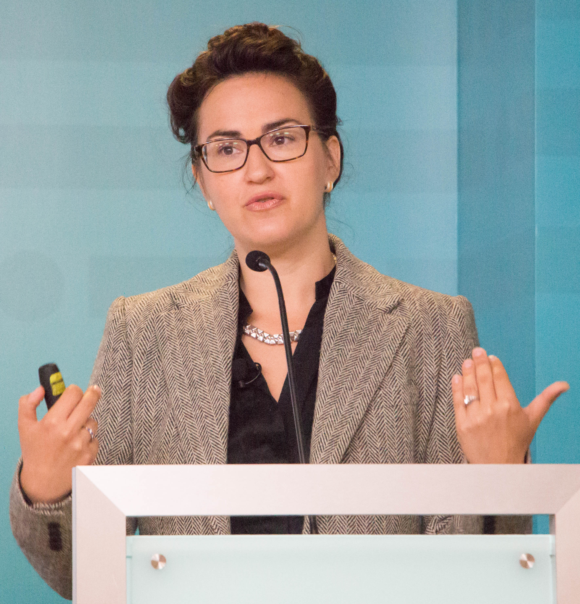

# Athena Aktipis

**Athena Aktipis** is an American evolutionary biologist and psychologist, professor of psychology at Arizona State University, known for framing cancer as somatic cellular cheating within [multicellular cooperation](multicellular-cooperation.md), for modeling cooperation and cheating in spatial agent-based simulations, and for empirical research on human mutual aid.

## Cancer as cellular cheating and spatial modeling

Aktipis argues that multicellular organisms function as evolutionarily maintained cooperative societies structured around shared cellular agreements: proliferation inhibition, regulated cell death, division of labor, resource allocation, and maintenance of the extracellular environment.[^1][^3] Cancer arises when somatic lineages defect from those constraints and win local selection at the organism's expense, driven by evolved life-history trade-offs across host tissues.[^2]

Using spatial agent-based models (such as NetLogo and lattice evolutionary simulations), Aktipis and collaborators tested how resource viscosity, apoptosis sensitivity, life-history trade-offs, and secreted public goods govern whether cheater cells invade a tissue or stay contained by cooperators.[^1][^3] Those models show that spatial structure and local tissue architecture—not intracellular repair alone—limit how long a multicellular body suppresses somatic defectors.

## Institutional building and human cooperation

Aktipis co-founded the Center for Evolution and Cancer at the University of California, San Francisco with [Carlo Maley](carlo-maley.md) and has served in the leadership of the International Society for Evolution, Ecology, and Cancer (ISEEC), including as Vice President and later President (2022–2025).

Outside oncology, she directs the Human Generosity Project, combining comparative anthropology—such as *osotua* need-based risk pooling among Maasai pastoralists—with agent-based models of mutual aid to study how need-based transfers stabilize cooperation under volatile environmental risk.

## See also

- [[multicellular-cooperation|Multicellular cooperation]]
- [[carlo-maley|Carlo Maley]]
- [[cancer-ecology|Cancer ecology]]

## References

[^1]: Aktipis CA, Nesse RM. Evolutionary foundations for cancer biology. *Evolutionary Applications*. 2013. [doi:10.1111/eva.12034](https://doi.org/10.1111/eva.12034).
[^2]: Aktipis CA, Boddy AM, Gatenby RA, Brown JS, Maley CC. Life history trade-offs in cancer evolution. *Nature Reviews Cancer*. 2013. [doi:10.1038/nrc3606](https://doi.org/10.1038/nrc3606).
[^3]: Aktipis A. *The Cheating Cell: How Evolution Helps Us Understand and Treat Cancer*. Princeton University Press, 2020.
