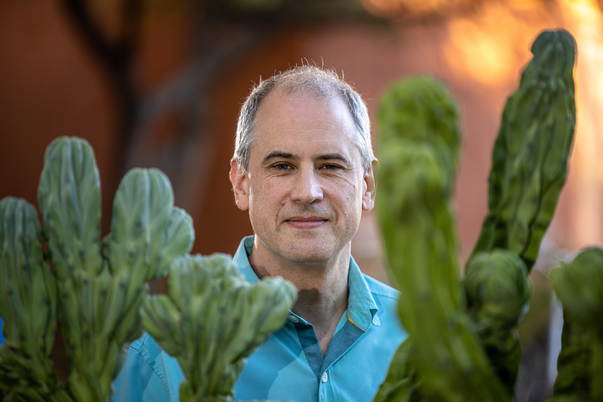

# Carlo Maley

**Carlo C. Maley** is an American evolutionary biologist and computer scientist, professor at Arizona State University and director of the Arizona Cancer Evolution Center. His work applies evolutionary and [ecological theory](cancer-ecology.md) to neoplastic progression, risk prediction, and comparative oncology.

## Career

Maley earned his PhD in computer science from the Massachusetts Institute of Technology and held faculty and research positions at the Wistar Institute and the University of California, San Francisco, where he co-founded the Center for Evolution and Cancer with [Athena Aktipis](athena-aktipis.md), before joining Arizona State University in 2015 in the Biodesign Institute and School of Life Sciences.

## Contributions

- **Eco-evolutionary oncology frameworks.** Maley and collaborators synthesized somatic mutation, clonal selection, microenvironmental hazards, and therapeutic resistance within formal population-ecology models, and later proposed an evolutionary-and-ecological (Evo-Eco) index to classify tumors by both genetic turnover and habitat stability.[^1][^4]
- **Clonal diversity and progression in Barrett's esophagus.** In prospective human cohorts of Barrett's esophagus—a premalignant metaplastic state with measurable progression risk—Maley's group showed that ecological diversity among tumor clones within biopsies predicts progression to esophageal adenocarcinoma, and traced crypt-level clonal expansion across space and time before overt malignancy.[^2][^3]
- **Comparative oncology.** Through the Arizona Cancer Evolution Center, Maley leads cross-species surveys of neoplasia and malignancy across vertebrates, testing how body mass, lifespan, and life-history strategy shape evolved tumor-suppression mechanisms relevant to [Peto's paradox](petos-paradox.md).

## References

[^1]: Merlo LMF, Pepper JW, Reid BJ, Maley CC. Cancer as an evolutionary and ecological process. *Nature Reviews Cancer*. 2006. [doi:10.1038/nrc2013](https://doi.org/10.1038/nrc2013).
[^2]: Maley CC, et al. Genetic clonal diversity predicts progression to esophageal adenocarcinoma. *Nature Genetics*. 2006. [doi:10.1038/ng1768](https://doi.org/10.1038/ng1768).
[^3]: Martinez P, Mallo D, Paulson TG, Li X, Sanchez CA, Reid BJ, Graham TA, Kuhner MK, Maley CC. Evolution of Barrett's esophagus through space and time at single-crypt and whole-biopsy levels. *Nature Communications*. 2017. [doi:10.1038/s41467-017-02621-x](https://doi.org/10.1038/s41467-017-02621-x).
[^4]: Maley CC, et al. Classifying the evolutionary and ecological features of neoplasms. *Nature Reviews Cancer*. 2017. [doi:10.1038/nrc.2017.69](https://doi.org/10.1038/nrc.2017.69).
