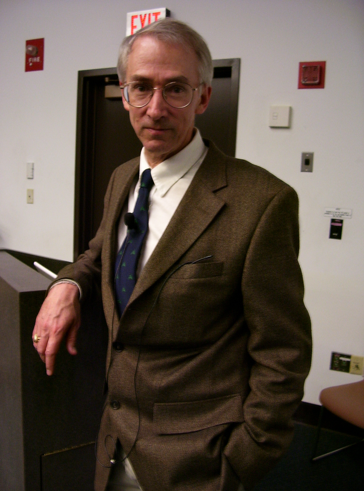

# David Sloan Wilson

David Sloan Wilson (born 1949) is an American evolutionary biologist and professor emeritus at Binghamton University, widely known as the leading contemporary proponent of [multilevel selection](multilevel-selection.md) theory and its extension to animal behavior, cultural evolution, and community design.

## Multilevel selection and empirical work

In the 1970s, Wilson revitalized group-selection reasoning with mathematical trait-group models showing how selection among ephemeral, localized interaction groups can outweigh within-group selection against cooperators. With philosopher Elliott Sober, he co-authored *Unto Others: The Evolution and Psychology of Unselfish Behavior* (1998), distilling the logic into the slogan: *"Selfishness beats altruism within groups. Altruistic groups beat selfish groups. Everything else is commentary."*

Alongside theory, Wilson conducted empirical field and laboratory research on **behavioral ecology and phenotypic divergence in freshwater fish**—notably studies with **Lee Alan Dugatkin** and **Beren Robinson** on **Trinidadian guppies (*Poecilia reticulata*)** and trout/sunfish foraging morphs—linking predation risk, cooperative predator inspection, social context, and local niche competition to rapid evolutionary differentiation across populations.

## Debates with inclusive-fitness theorists

Wilson's rehabilitation of multilevel selection sparked a sustained, sharp debate with Oxford social-evolution and inclusive-fitness theorists, including **Stuart West**, **Andy Gardner**, and **Ashleigh Griffin** (e.g., West et al., 2007, *"Social Semantics"*). Critics from the gene-centered camp argue that modern trait-group selection is mathematically equivalent to inclusive fitness ([Hamilton's rule](wd-hamilton.md)) and that invoking "group selection" risks reviving fuzzy group-adaptation fallacies and semantic confusion. Wilson (with Sober and later Martin Nowak and E. O. Wilson) replies that mathematical equivalence does not imply causal parity: multilevel covariance partitions highlight distinct ecological selection pressures—especially in non-kin groups, cultural institutions, and human organizations—that inclusive fitness bookkeeping often obscures.

## Prosociality and cultural applications

Wilson extended multilevel selection into cultural evolution and civic life—first in *Darwin's Cathedral* (2002), interpreting religious norms as group-cohesive adaptations, and then through applied intervention programs. Through the **Binghamton Neighborhood Project** and the broader **Prosocial** framework (integrating Elinor Ostrom's core design principles for governing commons with psychological flexibility), Wilson studies how transparent monitoring, fair conflict resolution, and group identity suppress within-group free-riding so neighborhoods, schools, and teams function cohesively. He synthesized this broader program in *This View of Life: Completing the Darwinian Revolution* (2019).

## Key works

- Sober, E., & Wilson, D. S. (1998). *Unto Others: The Evolution and Psychology of Unselfish Behavior*.
- Wilson, D. S. (2002). *Darwin's Cathedral*.
- Wilson, D. S. (2019). *This View of Life: Completing the Darwinian Revolution*.
