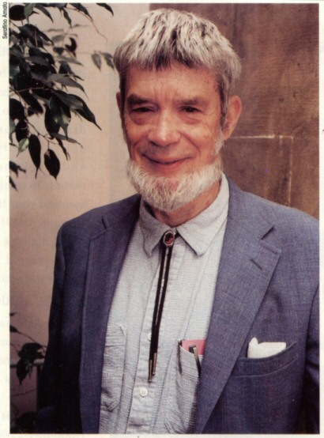

# George C. Williams

**George Christopher Williams** (May 12, 1926 – September 8, 2010) was an American evolutionary biologist, long-time professor at the State University of New York at Stony Brook, known for formulating [antagonistic pleiotropy](antagonistic-pleiotropy-theory.md), sharpening gene-centered evolutionary reasoning, and helping found evolutionary medicine.

## Biography and honors

Born in Charlotte, North Carolina, Williams earned his PhD at UCLA in 1955 and joined the faculty of SUNY Stony Brook in 1960, where he spent the remainder of his career. Alongside [W. D. Hamilton](wd-hamilton.md) and [John Maynard Smith](john-maynard-smith.md), he helped replace loose "good of the species" arguments with rigorous selection at the level of individuals and genes.[^2] In 1999, Williams shared the Crafoord Prize in Biosciences with Maynard Smith and Ernst Mayr.

## Antagonistic pleiotropy

In 1957, Williams proposed [antagonistic pleiotropy](antagonistic-pleiotropy-theory.md) to explain why aging evolves even under efficient natural selection.[^1] Because the [force of selection](selection-shadow-theory.md) weakens with age after reproductive maturity, alleles that enhance early survival or fertility can be favored by selection even if the same alleles impose physiological costs later in life.[^1] That logic frames late-life decline not solely as passive wear, but as a consequence of evolved pleiotropic trade-offs—a framework often debated in relation to early-life tumor suppression versus late-life tissue dysfunction.

## *Adaptation and Natural Selection* and later works

In *Adaptation and Natural Selection* (1966), Williams insisted that adaptive explanations attribute complex traits to selection among individuals or genes whenever possible, reserving group-level adaptation for unusually stringent conditions.[^2] He applied the same individual-level discipline to sexual reproduction in *Sex and Evolution* (1975), forcing evolutionary theory to account for the short-term fitness cost of males before appealing to long-term evolutionary advantages.[^3] With physician Randolph Nesse, Williams later co-authored *Why We Get Sick* (1994), establishing the field of evolutionary medicine around evolutionary mismatches, host–pathogen arms races, and physiological trade-offs.[^4]

## See also

- [[antagonistic-pleiotropy-theory|Antagonistic pleiotropy theory]]
- [[selection-shadow-theory|Selection shadow theory]]
- [[wd-hamilton|W. D. Hamilton]]

## References

[^1]: Williams GC. Pleiotropy, natural selection, and the evolution of senescence. *Evolution*. 1957;11(4):398–411. [doi:10.2307/2406060](https://doi.org/10.2307/2406060).
[^2]: Williams GC. *Adaptation and Natural Selection: A Critique of Some Current Evolutionary Thought*. Princeton University Press, 1966.
[^3]: Williams GC. *Sex and Evolution*. Princeton University Press, 1975.
[^4]: Nesse RM, Williams GC. *Why We Get Sick: The New Science of Darwinian Medicine*. Times Books, 1994.
