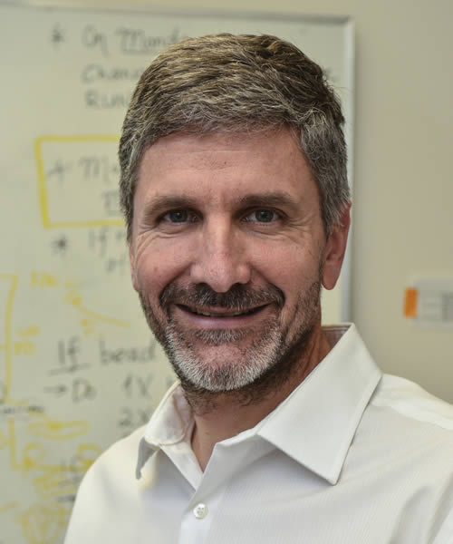

# James DeGregori

**James DeGregori** is an American cancer biologist, professor of biochemistry and molecular genetics at the University of Colorado Anschutz Medical Campus, known for formulating and testing the evolutionary theory of [adaptive oncogenesis](adaptive-oncogenesis.md).

## Adaptive oncogenesis and hematopoietic competition

Whereas classical mutation-centric models attribute rising cancer incidence with age primarily to cumulative mutation counts, DeGregori shifts the causal focus to *tissue selective context*.[^4] In young, intact tissues, wild-type stem and progenitor cells occupy a fitness peak, so oncogenic mutations rarely confer an advantage and often impose a fitness cost.[^2] When aging, chronic inflammation, or genotoxic injury impairs wild-type competitors, oncogenic alterations that restore survival or bypass damaged regulatory signals become positively selected.[^1][^2][^3]

DeGregori and collaborators tested this prediction using competitive bone-marrow transplantation and chimeric progenitor assays in mice:

- **Aged progenitors and *Bcr-Abl* selection.** Old mouse B-lymphoid progenitors show reduced receptor-kinase and IL-7 signaling relative to young progenitors. Introducing *Bcr-Abl* gave clones little advantage in young marrow but rescued Akt and STAT5 signaling in aged progenitors, driving leukemic expansion.[^2]
- **Irradiation-induced niche selection.** Ionizing radiation selects for *p53*-deficient hematopoietic progenitors primarily because it degrades the competitiveness of unmutated wild-type stem cells; restoring unirradiated wild-type competitors suppresses mutant expansion.[^1]
- **Chronic inflammation.** Age-related systemic inflammation reduces normal B-progenitor vigor and accelerates selection for oncogenic clones, whereas suppressing inflammation preserves wild-type competitiveness and blunts leukemogenesis without altering mutation rates.[^3]

DeGregori presented the full evolutionary synthesis in *Adaptive Oncogenesis: A New Understanding of How Cancer Evolves Inside Us* (2018).[^4]

## See also

- [[adaptive-oncogenesis|Adaptive oncogenesis]]
- [[clonal-evolution|Clonal evolution]]

## References

[^1]: Marusyk A, DeGregori J, et al. Irradiation selects for p53-deficient hematopoietic progenitors. *PLoS Biology*. 2010. [doi:10.1371/journal.pbio.1000324](https://doi.org/10.1371/journal.pbio.1000324).
[^2]: Henry CJ, Marusyk A, et al., DeGregori J. Declining lymphoid progenitor fitness promotes aging-associated leukemogenesis. *Proceedings of the National Academy of Sciences*. 2010;107(50):21713–21718. [doi:10.1073/pnas.1005486107](https://doi.org/10.1073/pnas.1005486107).
[^3]: Henry CJ, Casás-Selves M, Kim J, et al. Aging-associated inflammation promotes selection for adaptive oncogenic events in B cell progenitors. *Journal of Clinical Investigation*. 2015. [doi:10.1172/JCI83024](https://doi.org/10.1172/JCI83024).
[^4]: DeGregori J. *Adaptive Oncogenesis: A New Understanding of How Cancer Evolves Inside Us*. Harvard University Press, 2018.
