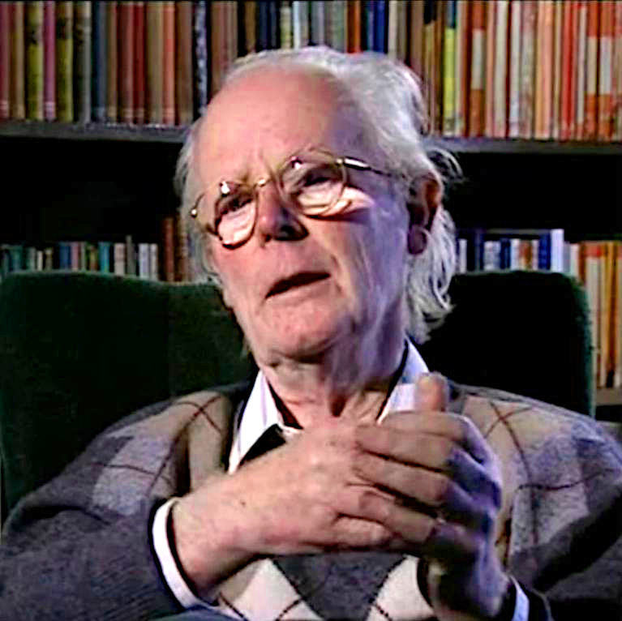

# John Maynard Smith

**John Maynard Smith** (1920–2004) was a British evolutionary biologist, professor at the University of Sussex, known for applying game theory to evolutionary biology, formulating the paradox of the evolution of sex, and co-authoring the [major evolutionary transitions](evolutionary-transitions-in-individuality.md) framework.

## Biography and honors

Maynard Smith trained in engineering at Trinity College, Cambridge, and worked as an aeronautical engineer during World War II before studying zoology and genetics at University College London under J. B. S. Haldane. After lecturing at University College London, he became founding dean and professor of biology at the University of Sussex. He received the Royal Medal of the Royal Society, the Kyoto Prize, and in 1999 shared the Crafoord Prize in Biosciences with [George C. Williams](george-c-williams.md) and Ernst Mayr.

## Evolutionary game theory and sex ratios

In the 1970s, drawing on work with George Price, Maynard Smith introduced mathematical game theory into evolution via the **evolutionarily stable strategy** (**ESS**)—a strategy that, once fixed in a population, cannot be invaded by any rare alternative mutant.[^2] In *Evolution and the Theory of Games* (1982), he framed animal contests, honest signaling, and Fisherian sex-ratio equilibrium as ESS problems: equal investment in sons and daughters emerges because any deviation grants an immediate frequency-dependent payoff to the rarer sex without requiring species-level coordination.[^2]

Earlier, in *The Evolution of Sex* (1978), Maynard Smith crystallized the **twofold cost of males** (or cost of meiosis): an asexual parthenogenetic female passes her entire genome to every daughter, whereas a sexual female invests half her reproductive output into sons that do not bear offspring.[^1] Accounting for why sexual reproduction persists despite that short-term twofold penalty became a central question motivating models such as the [Red Queen hypothesis](red-queen-hypothesis.md) and mutational purging.[^1]

## Major transitions

With [Eörs Szathmáry](eors-szathmary.md), Maynard Smith co-authored *The Major Transitions in Evolution* (1995), organizing the history of complexity around transitions in hereditary information storage and mechanisms that suppress competition among lower-level units.[^3] That framework underpins evolutionary models of [multicellular cooperation](multicellular-cooperation.md) and somatic defection in cancer.

## See also

- [[evolutionary-transitions-in-individuality|Evolutionary transitions in individuality]]
- [[eors-szathmary|Eörs Szathmáry]]
- [[red-queen-hypothesis|Red Queen hypothesis]]

## References

[^1]: Maynard Smith J. *The Evolution of Sex*. Cambridge University Press, 1978.
[^2]: Maynard Smith J. *Evolution and the Theory of Games*. Cambridge University Press, 1982.
[^3]: Maynard Smith J, Szathmáry E. *The Major Transitions in Evolution*. W. H. Freeman, 1995. ISBN 978-0-19-850294-4.
