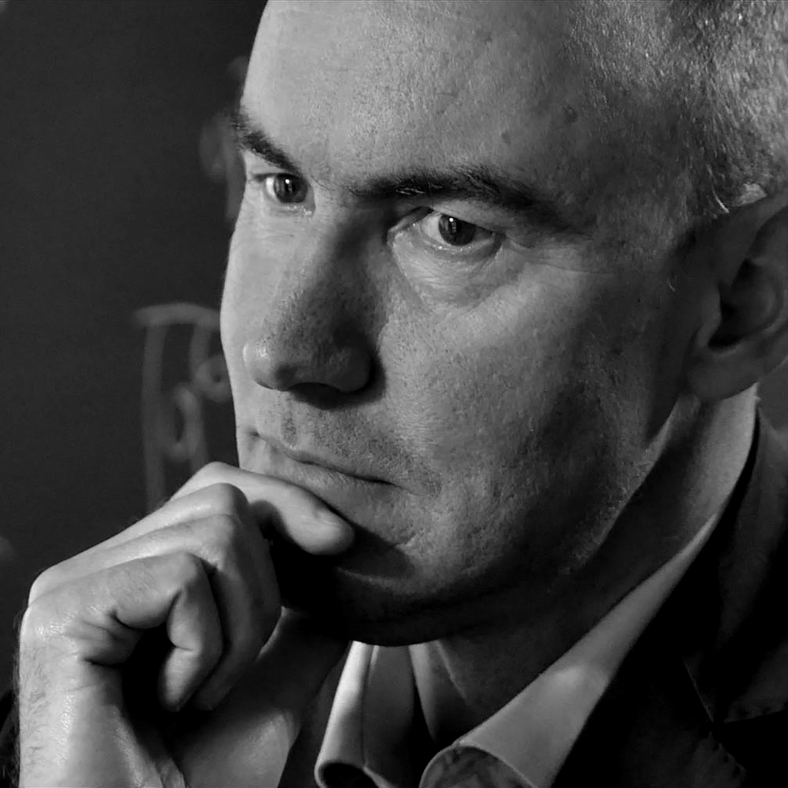

# Martin Nowak

Martin A. Nowak (born 1965) is an Austrian mathematical biologist, professor of biology and of mathematics at Harvard University, where he directs the Program for Evolutionary Dynamics. His work develops exact mathematical frameworks for the [evolution of cooperation](evolution-of-cooperation.md), viral quasispecies dynamics, and somatic carcinogenesis.

## Viral quasispecies and HIV antigenic diversity

Trained under Manfred Eigen's quasispecies tradition in Vienna, Nowak early on applied mathematical evolution to within-host viral dynamics. In a landmark 1991 *Science* paper with Roy Anderson, Angela McLean, Robert May, and colleagues (*"Antigenic diversity thresholds and the development of AIDS"*), he modeled HIV as an evolving population of antigenic escape mutants inside an infected host. During the long asymptomatic phase, immune responses contain low viral diversity; as cumulative viral variation crosses an **antigenic diversity threshold**, no finite T-cell repertoire can suppress all variants simultaneously, precipitating immune collapse and AIDS.

## Evolution of cooperation and *Evolutionary Dynamics*

With Karl Sigmund and collaborators, Nowak pioneered mathematical models of indirect reciprocity via reputation (1998, 2005) and evolutionary graph theory (Ohtsuki et al., 2006, establishing the $\frac{b}{c} > k$ threshold for cooperation on networks), later organizing these mechanisms into five formal rules for cooperation. His textbook ***Evolutionary Dynamics: Exploring the Equations of Life* (2006)** unified quasispecies equations, finite-population stochastic Moran processes, fixation probabilities in structured tissues, and evolutionary game dynamics. With science writer Roger Highfield, he presented this program for general readers in ***SuperCooperators* (2011)**.

## Somatic evolution of cancer

With collaborators including Franziska Michor and Yoh Iwasa, Nowak's group modeled tumor initiation in finite cell compartments, chronic myeloid leukemia progression and imatinib resistance, chromosomal instability, and two-hit tumor-suppressor inactivation in crypt/stem-cell architectures. This mathematical machinery directly underpins evolutionary arguments framing tumorigenesis as failure of [multicellular cooperation](multicellular-cooperation.md) and [multilevel selection](multilevel-selection.md).

## Career

Nowak previously held the Professorship of Mathematical Biology at the University of Oxford and led Theoretical Biology work at the Institute for Advanced Study in Vienna before joining Harvard University in 2003.

## Key works

- Nowak, M. A., Anderson, R. M., McLean, A. R., Wolfs, T. F., Goudsmit, J., & May, R. M. (1991). Antigenic diversity thresholds and the development of AIDS. *Science*, 254(5034), 963–969.
- Nowak, M. A. (2006). *Evolutionary Dynamics: Exploring the Equations of Life*.
- Ohtsuki, H., Hauert, C., Lieberman, E., & Nowak, M. A. (2006). A simple rule for the evolution of cooperation on graphs and social networks. *Nature*, 441, 502–505.
- Nowak, M. A., & Highfield, R. (2011). *SuperCooperators: Altruism, Evolution, and Why We Need Each Other to Succeed*.
