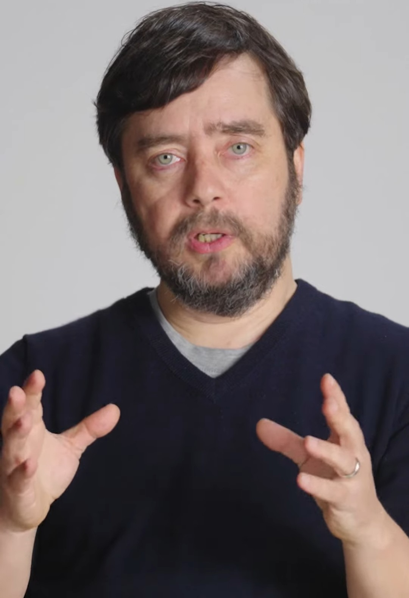

# Michael Levin

Michael Levin is an American developmental and synthetic biologist, Vannevar Bush Professor of Biology at Tufts University, where he directs the Allen Discovery Center and the Tufts Center for Regenerative and Developmental Biology. His work investigates [bioelectric signaling](bioelectricity.md), basal cognition, and the biophysical encoding of large-scale anatomical form during **morphogenesis**.

## Bioelectricity, planarian pattern memory, and brain regeneration

Levin's laboratory studies how voltage gradients ($V_{mem}$) and gap-junctional communication across non-neural somatic tissues encode anatomical target states. In addition to resetting planarian body-plan polarity into permanent two-headed lines and inducing ectopic *Xenopus* eyes via $V_{mem}$ perturbations, his team explored non-neural memory storage in regenerating flatworms.

In an automated behavioral conditioning study (Shomrat & Levin, *Journal of Experimental Biology*, 2013), planarians were trained to cross lit, open textures for food despite innate photophobia. When trained worms were decapitated, tail fragments regenerated entirely new heads and brains—yet behavioral testing showed that **the regenerated animals retained the acquired memory** of the previous brain. Along with persistent double-headed bioelectric pattern memory across amputations in plain water, these experiments support a somatic information-storage layer (bioelectric and physiological tissue state) able to imprint behavioral and anatomical setpoints onto newly forming structures.

## "Cognitive glue," morphospace, and cancer as scaled agency

Levin's theoretical framework models organisms as nested, multiscale collective intelligences operating within **morphospace** (the space of possible anatomical forms) well before nervous systems evolved:

- **Cognitive glue.** Gap junctions, bioelectric networks, and shared stress/error signals act as physiological *cognitive glue* that integrates semi-autonomous single cells—each retaining local metabolic and homeostatic competencies—into a larger multicellular agent capable of pursuing organ- and organism-level anatomical goals.
- **Cognitive light cone.** An agent's scale is defined by the spatial and temporal horizon ("cognitive light cone") over which it tracks errors and executes corrective action. As biological integration scales up during [evolutionary transitions in individuality](evolutionary-transitions-in-individuality.md), gap-junctional and bioelectric coupling expands that horizon from microns to centimeters.
- **Cancer as goal-scale contraction.** From this perspective, carcinogenesis represents neither simple clockwork damage nor pure genetic determinism alone, but a collapse of cellular **cognitive glue**: an uncoupled cell whose physiological gap-junction connections degrade contracts its behavioral boundary back down to unicellular survival and proliferation, treating surrounding host tissues as external environment. Experimental hyperpolarization and reconnection often restore cooperative tissue behavior in frog oncogene models without repairing underlying driver mutations.

The lab's synthetic biology work—including self-motile frog embryonic constructs (*Xenobots*, 2020)—extends these morphogenesis and collective-agency ideas into engineered living architectures.

## Key works

- Pai, V. P., Aw, S., Shomrat, T., Lemire, J. M., & Levin, M. (2012). Transmembrane voltage potential controls embryonic eye patterning in *Xenopus laevis*. *Development*, 139(2), 313–323.
- Shomrat, T., & Levin, M. (2013). An automated training paradigm reveals long-term memory in planaria and its persistence through head regeneration. *Journal of Experimental Biology*, 216(20), 3799–3810.
- Chernet, B. T., & Levin, M. (2013). Transmembrane voltage potential is an essential cellular parameter for the detection and control of tumor development in a *Xenopus* model. *Disease Models & Mechanisms*, 6(3), 595–607.
