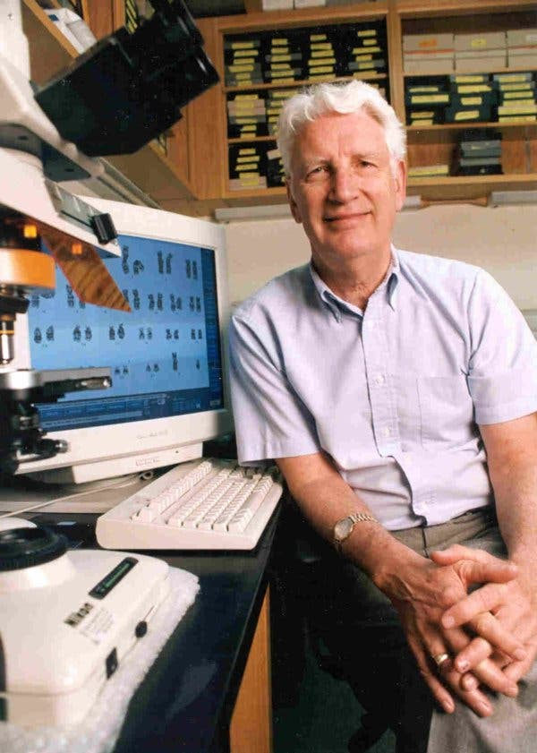

# Peter Nowell

**Peter C. Nowell** (1928–2016) was an American pathologist and cancer biologist at the Perelman School of Medicine at the University of Pennsylvania who co-discovered the Philadelphia chromosome and formulated the [clonal evolution](clonal-evolution.md) model of cancer.[^1][^2]

## Career and honors

Born in 1928, Nowell spent his academic career at the University of Pennsylvania, serving as Chair of the Department of Pathology and Laboratory Medicine from 1967 to 1973 while conducting research in hematologic malignancy and cytogenetics. For establishing the genetic basis of human neoplasia and clonal somatic evolution, he was elected to the National Academy of Sciences and the National Academy of Medicine, and shared the 1998 Albert Lasker Clinical Medical Research Award alongside Janet Rowley and Alfred Knudson.

## The Philadelphia chromosome

In 1960, Nowell and his graduate fellow David Hungerford identified a consistently foreshortened chromosome in leukemic cells from patients with chronic myeloid leukemia (CML), named the **Philadelphia chromosome** after the city of its discovery.[^1] It was the first reproducible chromosomal abnormality linked to any human malignancy. Janet Rowley later established that the abnormality resulted from a reciprocal t(9;22) chromosomal translocation creating the *BCR-ABL* fusion oncogene, providing the molecular target later exploited by tyrosine-kinase therapy with imatinib.

## Clonal evolution of cancer

In 1976, Nowell synthesized cytogenetic and clinical observations into a unified evolutionary model of tumor progression.[^2] He proposed that most neoplasms arise from a single transformed somatic cell and advance through stepwise genetic instability, generating mutant subclones upon which microenvironmental selection and therapy act sequentially.[^2] That framework underpins branching-evolution tumor genomics, [cancer ecology](cancer-ecology.md), and evolutionary dosing strategies such as [adaptive therapy](adaptive-therapy.md).

## References

[^1]: Nowell PC, Hungerford DA. A minute chromosome in human chronic granulocytic leukemia. *Science*. 1960;132(3438):1497.
[^2]: Nowell PC. The clonal evolution of tumor cell populations. *Science*. 1976. [doi:10.1126/science.959840](https://doi.org/10.1126/science.959840).
