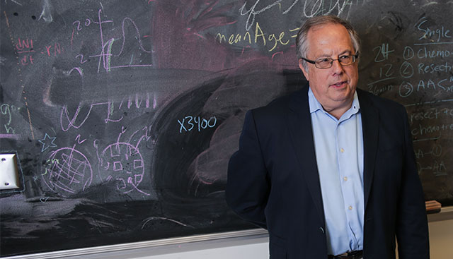

# Robert Gatenby

**Robert A. Gatenby** is an American physician-scientist, radiologist, and professor at the Moffitt Cancer Center in Tampa, Florida, known for introducing [adaptive therapy](adaptive-therapy.md) and applying [evolutionary ecology](cancer-ecology.md) to tumorigenesis and drug resistance.[^1][^2]

## Warburg effect and metabolic tumor ecology

In collaboration with Robert J. Gillies, Gatenby reframed the **Warburg effect**—aerobic glycolysis in cancer cells despite the presence of oxygen—as an evolutionary adaptation to fluctuating glucose and oxygen gradients in avascular premalignant lesions.[^1]

In their ecological model, cells growing away from blood vessels experience intermittent hypoxia and select for upregulated constitutive glycolysis. Exporting lactic acid and protons ($H^+$) lowers the extracellular pH of surrounding tissue: normal somatic cells undergo acid-induced death and matrix metalloproteinases degrade the extracellular matrix, while acid-adapted tumor clones survive and invade the cleared niche (**acid-mediated invasion**).[^1] Glucose competition and pH niche construction thus operate as ecological weapons against adjacent host tissue.

## Evolutionary game theory and adaptive therapy

Working alongside evolutionary ecologist Joel Brown and mathematician Kateřina Staňková, Gatenby paired Lotka–Volterra resource-competition models with evolutionary game theory to show that maximum-tolerated-dose (MTD) chemotherapy triggers an avoidable evolutionary failure: eliminating drug-sensitive cells removes resource competition and induces rapid expansion of resistant lineages (*competitive release*).[^2][^3] Under their adaptive dosing protocol and subsequent Stackelberg game formulations, the clinician acts as a strategic leader modulating treatment intensity so that fitter sensitive clones persist and competitively suppress resistant cells.[^2][^3]

In a 2017 pilot clinical trial of intermittent abiraterone dosing in metastatic castration-resistant prostate cancer, this approach extended median time to progression to at least 27 months while reducing average cumulative drug exposure to roughly 47% of standard continuous therapy.[^4] At Moffitt, Gatenby founded the Integrated Mathematical Oncology program and co-directs the Center of Excellence for Evolutionary Therapy.

## References

[^1]: Gatenby RA, Gillies RJ. Why do cancers have high aerobic glycolysis? *Nature Reviews Cancer*. 2004. [doi:10.1038/nrc1478](https://doi.org/10.1038/nrc1478).
[^2]: Gatenby RA, Silva AS, Gillies RJ, Frieden BR. Adaptive therapy. *Cancer Research*. 2009. [doi:10.1158/0008-5472.CAN-08-3658](https://doi.org/10.1158/0008-5472.CAN-08-3658).
[^3]: Gatenby RA, Brown JS. Integrating evolutionary dynamics into cancer therapy. *Nature Reviews Clinical Oncology*. 2020. [doi:10.1038/s41571-020-0411-1](https://doi.org/10.1038/s41571-020-0411-1).
[^4]: Zhang J, Cunningham JJ, Brown JS, Gatenby RA. Integrating evolutionary dynamics into treatment of metastatic castrate-resistant prostate cancer. *Nature Communications*. 2017;8:1816. [doi:10.1038/s41467-017-01968-5](https://doi.org/10.1038/s41467-017-01968-5).
