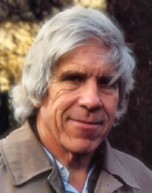

# W. D. Hamilton

William Donald Hamilton (1936–2000) was a British evolutionary biologist widely regarded as one of the deepest theorists of twentieth-century Darwinism. He formulated inclusive fitness (kin selection), formalized the evolutionary [force of selection](selection-shadow-theory.md) underlying senescence, pioneered sex-ratio game theory, and developed the parasite-driven [Red Queen hypothesis](red-queen-hypothesis.md) for the evolution of sex.

## Inclusive fitness and *Narrow Roads of Gene Land*

After academic positions including Imperial College London and later a professorship at the University of Oxford, Hamilton collected his major papers in the three-volume ***Narrow Roads of Gene Land***—remarkable not only for the primary papers, but for his candid autobiographical introductions to each piece:

- **Volume 1:** *The Evolution of Social Behaviour* (1996) — anchored by his 1964 *"The Genetical Evolution of Social Behaviour"*, which established Hamilton's rule ($rb > c$) as the mathematical centerpiece of social evolution and altruism.
- **Volume 2:** *The Kindred of the Troublesome Male* (2001) — centered on sexual reproduction, sex ratios, and host–parasite coevolution.
- **Volume 3:** *Last Words* (2005, posthumous) — late theoretical essays and field reflections.

## Extraordinary sex ratios (1967)

In his 1967 *Science* paper *"Extraordinary sex ratios"*, Hamilton explained why Fisher's classic argument for an equal 1:1 sex ratio fails whenever mating is structured rather than panmictic. When brothers compete locally with each other for mates inside subdivided patches (**local mate competition**, e.g. in parasitic wasps and fig wasps), selection favors mothers producing heavily female-biased broods—only enough sons to inseminate the sisters in the patch. Hamilton also analyzed driving X-linked and Y-linked sex-ratio distorters as intragenomic conflicts, introducing unbeatable-strategy reasoning that directly anticipated [John Maynard Smith](john-maynard-smith.md)'s evolutionarily stable strategy (ESS).

## Force of selection, parasites, and senescence

In 1966 (*Journal of Theoretical Biology*), Hamilton derived quantitative indicator functions showing how the [force of selection](selection-shadow-theory.md) on age-specific survival and fertility inevitably declines with age after reproductive onset, providing the rigorous mathematical foundation for Medawar's mutation-accumulation model and [George C. Williams](george-c-williams.md)'s [antagonistic pleiotropy](antagonistic-pleiotropy-theory.md). He also published *"Sex versus non-sex versus parasite"* (*Oikos*, 1980), arguing that cycling host–parasite coevolution rescues sexual recombination despite its twofold cost.

Hamilton received the Crafoord Prize and the Kyoto Prize, and died in 2000 from complications of malaria contracted during fieldwork in the Congo.

## Key works

- Hamilton, W. D. (1964). The genetical evolution of social behaviour. *Journal of Theoretical Biology*.
- Hamilton, W. D. (1966). The moulding of senescence by natural selection. *Journal of Theoretical Biology*.
- Hamilton, W. D. (1967). Extraordinary sex ratios. *Science*.
- Hamilton, W. D. (1980). Sex versus non-sex versus parasite. *Oikos*.
- Hamilton, W. D. (1996, 2001, 2005). *Narrow Roads of Gene Land* (Vols. 1–3).
